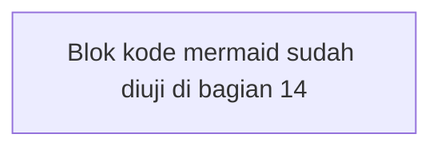
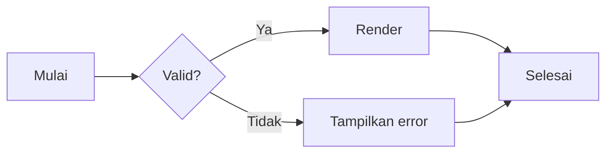
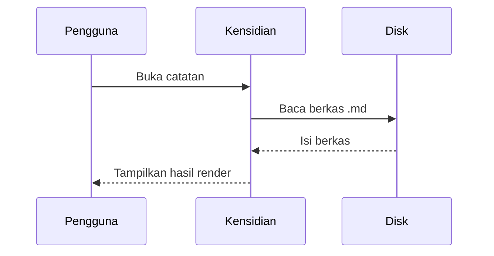
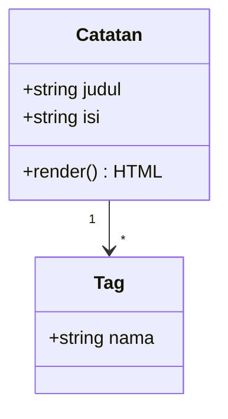
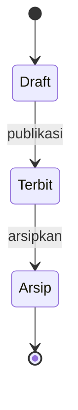
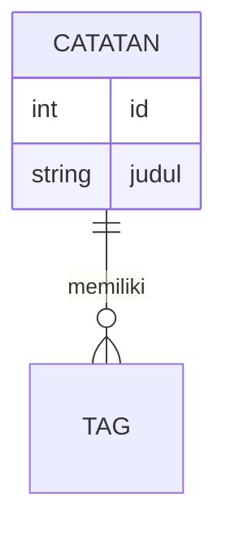
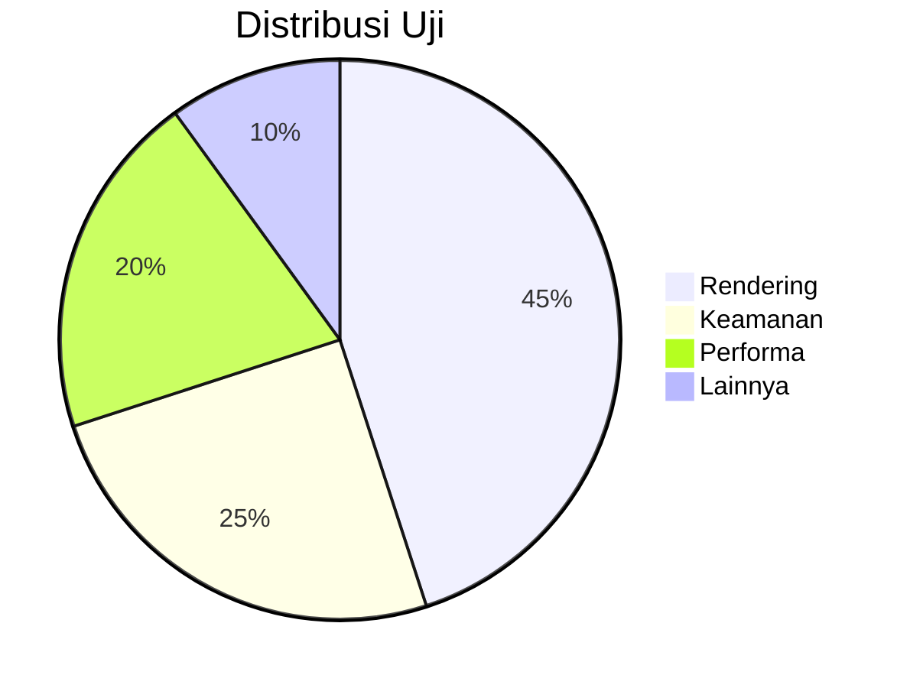
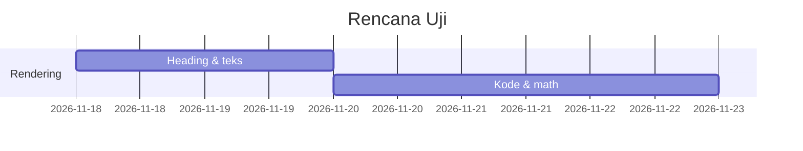

# Kensidian — Dokumen Uji Rendering Lengkap

Dokumen ini dirancang untuk **menemukan bug rendering**. Setiap bagian punya baris **Ekspektasi** (hasil yang benar) supaya mudah menentukan lulus atau gagal. Bagian bernomor 00–25 aman dibuka biasa; bagian **99** sengaja berisiko (rekursi, sintaks tidak tertutup) dan ditaruh paling akhir.

**Cara pakai:**

1. Buka dokumen di mode **Reading/Preview**, lalu ulangi di mode **Source/Live Preview** (jika ada).
2. Ulangi di **tema gelap dan terang**.
3. Ulangi di lebar jendela **sempit (≈360 px)** dan **lebar (≥1440 px)**.
4. Cek konsol browser: tidak boleh ada error/warning saat render.
5. Cetak/ekspor ke PDF dan cek hasilnya (jika fitur ada).

Daftar isi (uji tautan anchor, dua gaya sekaligus):

- [[#00. Ringkasan target uji]] · [Markdown anchor](#00-ringkasan-target-uji)
- [[#02. Heading]] · [Markdown anchor](#02-heading)
- [[#10. Callout]] · [Markdown anchor](#10-callout)
- [[#13. Blok kode & bahasa pemrograman]] · [Markdown anchor](#13-blok-kode--bahasa-pemrograman)
- [[#15. Matematika (LaTeX)]] · [Markdown anchor](#15-matematika-latex)
- [[#22. Keamanan & sanitasi]] · [Markdown anchor](#22-keamanan--sanitasi)

---

## 00. Ringkasan target uji

| No | Area | Yang diuji |
| ---: | :--- | :--- |
| 01 | Properties | Frontmatter di atas dokumen |
| 02 | Heading | H1–H6, setext, duplikat, anchor |
| 03 | Paragraf & Unicode | Baris baru, emoji, CJK, RTL |
| 04 | Format inline | Bold, italic, highlight, dst. |
| 05 | Color chip | HEX/RGB/HSL di kode inline & blok kode |
| 06 | Tautan | Wikilink, tag, block ID, autolink |
| 07–08 | Embed & gambar | Transklusi, ukuran, gambar rusak |
| 09–11 | Blockquote, callout, daftar | Nesting, fold, checkbox kustom |
| 12–14 | Tabel, kode, Mermaid | Overflow, escape pipe, 40+ bahasa |
| 15–16 | Math, footnote | Inline, blok, error LaTeX |
| 17–22 | HTML, komentar, escape, sanitasi | Termasuk uji XSS |
| 23–24 | Stress & ekstensi | Nesting dalam, baris panjang |

---

## 01. Frontmatter & Properties

**Ekspektasi:** blok `---` di baris pertama **tidak** tampil sebagai garis horizontal/teks. Jika Kensidian punya panel Properties, nilainya tampil sesuai tipe: teks (`status`), angka (`versi`, `prioritas`, `rating`), checkbox (`selesai`), tanggal (`tanggal`), tanggal-waktu (`tanggal-waktu`), daftar (`aliases`, `tags`, `cssclasses`), link (`tautan`), URL (`url`), nilai kosong (`kosong`), dan objek bersarang (`nested`) **tanpa crash**.

Frontmatter palsu (bukan di baris pertama) harus dirender sebagai garis + teks biasa:

---
judul: ini bukan frontmatter
---

---

## 02. Heading

**Ekspektasi:** enam level tampil dengan ukuran menurun dan kontras jelas; tidak ada level yang tenggelam di latar.

# H1 — Heading Level 1
## H2 — Heading Level 2
### H3 — Heading Level 3
#### H4 — Heading Level 4
##### H5 — Heading Level 5
###### H6 — Heading Level 6

Heading gaya setext:

Setext Level 1
==============

Setext Level 2
--------------

Heading dengan isi campuran:

### Heading dengan **bold**, *italic*, `kode`, ==highlight==, dan [tautan](https://example.com)
### Heading dengan emoji 🚀 dan simbol & < > "kutip"
### Heading dengan rumus $E = mc^2$ dan warna `#61afef`
### Heading dengan wikilink [[Catatan Lain]] dan tag #tag-heading
### Heading sangat panjang yang sengaja dibuat berlarut-larut untuk menguji apakah teks heading terbungkus (wrap) dengan benar, tidak terpotong, tidak meluber keluar kontainer, dan tetap rapi di layar sempit maupun lebar

### Duplikat
Isi pertama.

### Duplikat
Isi kedua. **Ekspektasi:** anchor kedua tidak bentrok dengan yang pertama (contoh `#duplikat` dan `#duplikat-1`).

Bukan heading (**tidak boleh** jadi heading):

#TanpaSpasi
####### Tujuh pagar
\# Pagar di-escape
    # Indentasi 4 spasi (jadi blok kode)

Heading dengan pagar penutup:

## Penutup Pagar ##

Heading kosong (**ekspektasi:** tidak crash):

##

---

## 03. Paragraf, baris baru, & Unicode

**Ekspektasi:** teks tampil utuh tanpa karakter rusak (mojibake) dan tanpa kotak kosong.

Paragraf pertama dengan beberapa kalimat. Lorem ipsum dolor sit amet, consectetur adipiscing elit, sed do eiusmod tempor incididunt ut labore et dolore magna aliqua.
Baris ini langsung menyambung tanpa baris kosong (soft break; tampilan bergantung pengaturan "strict line breaks").

Baris dengan dua spasi di akhir (hard break)  
ini baris baru.

Baris dengan backslash di akhir (hard break)\
ini baris baru.

Baris dengan tag br<br>ini baris baru.

Kata tanpa spasi sangat panjang (uji overflow horizontal): Pneumonoultramicroscopicsilicovolcanoconiosis_Pneumonoultramicroscopicsilicovolcanoconiosis_Pneumonoultramicroscopicsilicovolcanoconiosis_Pneumonoultramicroscopicsilicovolcanoconiosis

URL panjang tanpa spasi: https://example.com/jalur/yang/sangat/panjang/sekali/untuk/menguji/pembungkusan/teks/di/layar/sempit/dan/lebar/sekali/index.html?parameter1=nilai1&parameter2=nilai2&parameter3=nilai3

### Unicode & bahasa

- Latin beraksen: café, naïve, Zürich, São Paulo, Łódź, Ångström, İstanbul
- Karakter gabungan (combining): e + ´ = é, n + ˜ = ñ, Z̷̢a̶l̸g̵o̴ (zalgo)
- Jepang: 日本語のテキストです。漢字、ひらがな、カタカナ
- Mandarin: 这是一段中文文本，测试全角标点。
- Korea: 한국어 텍스트 테스트입니다.
- Arab (RTL): مرحبا بالعالم، هذا اختبار للنص من اليمين إلى اليسار
- Ibrani (RTL): שלום עולם, זה מבחן
- Campuran RTL & LTR: Kensidian adalah «تطبيق» untuk catatan 123.
- Thai (tanpa spasi antar kata): สวัสดีชาวโลกนี่คือการทดสอบ
- Devanagari: नमस्ते दुनिया
- Aksara Jawa: ꦲꦏ꧀ꦱꦫꦗꦮ
- Emoji dasar: 😀 🎉 🚀 ✅ ❌ ⚠️ ❤️
- Emoji ZWJ & bendera: 👨‍👩‍👧‍👦 👩🏽‍💻 🏳️‍🌈 🇮🇩 🇯🇵
- Simbol: © ® ™ § ¶ † ‡ • → ← ↑ ↓ ⇒ ≠ ≈ ≤ ≥ ∞ ∑ ∏ √ ∫ ° µ
- Spasi nol-lebar di tengah kata: kata​gabung (ada U+200B di antara "kata" dan "gabung")
- Spasi tak-pecah (NBSP): satu dua tiga

Entitas HTML: &amp; &lt; &gt; &quot; &copy; &nbsp; &#9731; &#x1F600; &hearts;

---

## 04. Format teks inline

**Ekspektasi:** setiap gaya tampil berbeda dan terbaca di tema gelap/terang; tidak ada gaya yang "bocor" ke teks sesudahnya.

- Teks biasa (normal) untuk membaca artikel panjang.
- **Tebal** dengan asterisk dan __tebal__ dengan underscore.
- *Miring* dengan asterisk dan _miring_ dengan underscore.
- ***Tebal-miring*** dan ___tebal-miring___ dan **_campuran_** dan _**campuran**_.
- ~~Coretan (strikethrough)~~ dan ~~coretan dengan **tebal** di dalam~~.
- ==Highlight / stabilo== dan ==highlight dengan **tebal** dan *miring*==.
- `kode inline`, ``kode dengan `backtick` di dalam``, dan ` spasi di tepi `.
- Superscript HTML: x<sup>2</sup>, subscript: H<sub>2</sub>O, garis bawah: <u>underline</u>, tanda: <mark>mark</mark>, singkatan: <abbr title="HyperText Markup Language">HTML</abbr>.
- Tombol keyboard: <kbd>Ctrl</kbd> + <kbd>Shift</kbd> + <kbd>P</kbd>, <kbd>⌘</kbd> + <kbd>K</kbd>, <kbd>Alt</kbd>
- Teks kecil: <small>small text</small>, teks besar: <big>big</big> (opsional).
- Warna lewat HTML: <span style="color: purple;">ungu</span>, <span style="color: #e06c75;">koral</span>, <span style="background: #e5c07b; color: #000;">latar kuning</span>

Kasus tepi emphasis:

- snake_case_variable_name (**tidak boleh** jadi miring)
- 2*3*4 = 24 (intraword asterisk; perilaku sesuai CommonMark)
- foo**bar**baz (bold di tengah kata, valid)
- **tebal****tebal-lagi** (dua bold berurutan)
- ***a** b* dan ***a* b**
- ** bukan tebal ** (ada spasi di dalam penanda)
- Harga 5 * 3 * 2 (asterisk dengan spasi, **bukan** miring)
- ~~satu~~ ~dua~ ~~~tiga~~~

---

## 05. Color chip & kode warna

Bagian ini mereplikasi tampilan target: **kotak warna kecil (chip)** di samping kode warna.

**Ekspektasi:** chip muncul untuk kode warna valid **di dalam kode inline** dan **di dalam blok kode**; warna tidak valid tetap teks kode biasa tanpa chip dan tanpa error.

# Palet Warna Desain Antarmuka

| Tipe Elemen | Format HEX | Format RGB / RGBA | Format HSL |
| :--- | :--- | :--- | :--- |
| **Primary Accent** | `#61afef` | `rgb(97, 175, 239)` | `hsl(207, 82%, 66%)` |
| **Success Alert** | `#98c379` | `rgb(152, 195, 121)` | `hsl(95, 38%, 62%)` |
| **Warning / Amber** | `#e5c07b` | `rgb(229, 192, 123)` | `hsl(39, 67%, 69%)` |
| **Danger / Coral** | `#e06c75` | `rgba(224, 108, 117, 0.9)` | `hsl(355, 65%, 65%)` |
| **Purple Violet** | `#c678dd` | `rgb(198, 120, 221)` | `hsl(286, 60%, 67%)` |
| **Muted Slate** | `#5c6370` | `rgba(92, 99, 112, 0.6)` | `hsl(219, 10%, 40%)` |

Varian: nilai RGB **tanpa kode inline** (di screenshot target, satu sel berupa teks biasa dan tetap mendapat chip; tentukan apakah itu disengaja):

| Tipe Elemen | HEX (kode) | RGB (teks biasa) |
| :--- | :--- | :--- |
| **Primary Accent** | `#61afef` | rgb(97, 175, 239) |
| **Success Alert** | `#98c379` | rgb(152, 195, 121) |

### 05a. Format valid (harus ada chip)

- 3 digit: `#fff` · `#0af` · `#F00`
- 4 digit (alpha): `#fff8` · `#0af4`
- 6 digit: `#61afef` · `#61AFEF` · `#000000`
- 8 digit (alpha): `#61afef80` · `#e06c75ff` · `#00000000`
- RGB koma: `rgb(97, 175, 239)` · `rgb(0,0,0)` · `rgb(255,255,255)`
- RGBA: `rgba(224, 108, 117, 0.9)` · `rgba(255,255,255,.12)` · `rgba(0, 0, 0, 0)`
- RGB sintaks modern: `rgb(97 175 239)` · `rgb(97 175 239 / 50%)` · `rgb(100% 50% 0%)`
- HSL: `hsl(207, 82%, 66%)` · `hsl(207 82% 66%)` · `hsl(207deg, 82%, 66%)`
- HSLA: `hsla(207, 82%, 66%, 0.5)` · `hsl(207 82% 66% / 0.5)`
- HWB: `hwb(207 30% 10%)`
- Nama warna CSS: `red` · `rebeccapurple` · `tomato` · `transparent` (dukungan nama warna opsional)
- Tingkat lanjut (opsional): `oklch(0.7 0.15 250)` · `lab(60% 20 -40)` · `color(display-p3 1 0 0)` · `color-mix(in srgb, red 50%, blue)`

### 05b. Format tidak valid (tidak boleh ada chip, tidak boleh error)

- `#12` · `#12345` · `#1234567` · `#gggggg` · `#` · `# 61afef`
- `rgb(1, 2)` · `rgb(a, b, c)` · `rgba(1,2,3,4,5)` · `rgb()` · `rgb(97, 175, 239`
- `hsl(400, 200%, 50%)` · `hsl(abc)` · `hsl(207, 82, 66)`
- `var(--brand-primary)` · `inherit` · `currentColor` · `not-a-color` · `unset`
- `61afef` (tanpa pagar) · `0xFF0000` · `#61afef;` · `#61afef, #98c379` (dua nilai dalam satu kode)

### 05c. Warna di konteks lain

Warna di **teks biasa** (bukan kode): #61afef, rgb(97, 175, 239), hsl(207, 82%, 66%).
Catatan: `#61afef` di teks biasa bisa dianggap **tag** karena mengandung huruf; `#123456` (semua angka) **bukan** tag.

Kode warna di dalam: **tebal `#e06c75`**, *miring `#98c379`*, ==highlight `#c678dd`==, [tautan `#61afef`](https://example.com).

> Blockquote dengan warna `#e5c07b` dan `rgba(92, 99, 112, 0.6)`.

> [!TIP] Callout dengan warna
> Gunakan `#61afef` untuk aksen utama dan `hsl(95, 38%, 62%)` untuk status sukses.

1. Daftar bernomor dengan `#98c379`
2. Daftar bernomor dengan `rgb(224 108 117)`

### 05d. Warna di blok kode

```css
/* Konfigurasi Tema UI */
:root {
  --brand-primary: #61afef;
  --brand-surface: #282c34;
  --brand-border: rgba(255, 255, 255, 0.12);
  --text-title: #ffffff;
  --text-body: hsl(219, 14%, 71%);
  --accent-purple: rgb(198 120 221 / 80%);
  --danger: #e06c75;
  --invalid-1: #12345;
  --invalid-2: var(--brand-primary);
  --named: rebeccapurple;
}

.card {
  background: linear-gradient(135deg, #61afef 0%, #c678dd 100%);
  box-shadow: 0 4px 24px rgba(0, 0, 0, 0.35);
  border: 1px solid var(--brand-border);
}
```

```json
{
  "colors": {
    "primary": "#61afef",
    "success": "rgb(152, 195, 121)",
    "danger": "hsl(355, 65%, 65%)",
    "bukanWarna": "#12345"
  }
}
```

```javascript
const palette = ["#61afef", "#98c379", "#e5c07b", "#e06c75"];
const el = document.querySelector(".box");
el.style.color = "rgba(255, 255, 255, 0.9)";
```

```html
<div style="color: #e06c75; background: hsl(207, 82%, 66%)">Warna inline</div>
```

```scss
$primary: #61afef;
$surface: darken($primary, 40%);
.btn { background: $primary; &:hover { background: lighten($primary, 8%); } }
```

```text
Teks polos tanpa bahasa: #61afef rgb(97, 175, 239) hsl(207, 82%, 66%)
```

---

## 06. Tautan, wikilink, tag, & block ID

**Ekspektasi:** tautan valid, tautan rusak, dan tautan eksternal punya gaya **berbeda**. Tautan eksternal membuka dengan aman (idealnya `rel="noopener noreferrer"`). Tidak ada tautan yang diproses di dalam blok kode.

### Tautan Markdown

- Biasa: [Situs Google](https://google.com)
- Dengan title: [Hover saya](https://example.com "Ini title tooltip")
- Autolink: <https://example.com> dan <mailto:test@example.com>
- URL telanjang: https://example.com/jalur?x=1&y=2#bagian
- Email telanjang: test@example.com
- Referensi: [tautan referensi][ref-1] dan [tautan implisit][] serta [singkat]
- Relatif: [file lokal](./folder/berkas.md) dan [naik](../atas/berkas.md)
- Anchor internal: [lompat ke Heading](#02-heading)
- Spasi di URL: [dengan spasi](<jalur dengan spasi/berkas.md>)
- URL dengan kurung: [Wikipedia](https://id.wikipedia.org/wiki/Kensidian_(aplikasi))
- Tautan kosong: [teks tanpa url]() dan [](https://example.com)
- Tautan dalam format: **[tebal](https://example.com)** dan *[miring](https://example.com)*
- Tautan dengan gambar: [](https://example.com)

[ref-1]: https://example.com/referensi-1 "Judul Referensi"
[tautan implisit]: https://example.com/implisit
[singkat]: https://example.com/singkat

### Wikilink (gaya Obsidian)

- Valid: [[Catatan Lain]]
- Alias: [[Catatan Lain|Nama Kustom]]
- Heading: [[Catatan Lain#Heading Tertentu]]
- Heading + alias: [[Catatan Lain#Heading Tertentu|Lompat ke heading]]
- Block: [[Catatan Lain#^blok-id-tertentu]]
- Lokal: [[#02. Heading]] dan [[#^blok-uji-1]]
- Folder/path: [[Folder/Subfolder/Catatan Dalam]]
- Dengan ekstensi: [[Catatan Lain.md]]
- **Rusak (tidak ada):** [[Halaman Ini Belum Ada]] (gaya harus beda dari tautan valid)
- Karakter khusus: [[Catatan: Uji & "Kutip" (Kurung)]]
- Unicode: [[日本語のノート]] dan [[Catatan Ünïcode]]
- Panjang: [[Catatan dengan judul yang sangat panjang sekali sampai harus membungkus ke baris berikutnya di layar sempit]]
- Huruf besar-kecil: [[catatan lain]] dan [[CATATAN LAIN]] (resolusi case-insensitive)
- Di dalam kode (**tidak boleh** jadi tautan): `[[Catatan Lain]]`
- Wikilink kosong: [[]] dan [[|alias saja]]

### Tag

- Sederhana: #tes #uji #kensidian
- Bertingkat: #tes-warna/sub-warna #proyek/kensidian/rendering
- Dengan angka: #v2 #2026-uji #uji2
- Hanya angka (**bukan tag**): #123 #2026
- Unicode: #catatan-ünï #ujian-日本
- Underscore & dash: #snake_case_tag #kebab-case-tag
- Di dalam kode (**bukan tag**): `#bukan-tag`
- Di tengah kata (**bukan tag**): C#, F#, nama#belakang, url.com/#anchor
- Setelah tanda baca: (#dalam-kurung), "#dalam-kutip", #akhir-kalimat.
- Tag dalam heading sudah diuji di bagian 02.

### Block ID

Paragraf ini punya block ID dan dapat ditautkan dari tempat lain. ^blok-uji-1

- Item daftar dengan block ID ^blok-item-1
- Item lain tanpa block ID

> Kutipan dengan block ID.
^blok-kutipan-1

---

## 07. Embed (transklusi)

**Ekspektasi:** embed valid menampilkan isi catatan lain; embed rusak menampilkan placeholder jelas (bukan crash); embed tidak boleh berulang tak terbatas (lihat bagian 99).

- Catatan penuh: ![[Catatan Lain]]
- Heading tertentu: ![[Catatan Lain#Heading Tertentu]]
- Block tertentu: ![[Catatan Lain#^blok-id-tertentu]]
- Gambar vault: ![[gambar-contoh.png]]
- Gambar + lebar: ![[gambar-contoh.png|300]]
- Gambar + lebar x tinggi: ![[gambar-contoh.png|300x150]]
- Gambar + alt: ![[gambar-contoh.png|Teks alternatif]]
- PDF: ![[dokumen.pdf]] · PDF halaman: ![[dokumen.pdf#page=3]]
- Audio: ![[audio.mp3]]
- Video: ![[video.mp4]]
- Embed rusak: ![[File Yang Tidak Ada]]
- Embed dalam kode (**tidak boleh** aktif): `![[Catatan Lain]]`

---

## 08. Gambar

**Ekspektasi:** gambar tampil proporsional, tidak melebihi lebar kontainer, dan gambar rusak menampilkan alt text/ikon rusak tanpa merusak layout.

Gambar SVG data-URI (tanpa file eksternal):


Gambar lebar 1200 px (harus mengecil mengikuti kontainer):


- Gambar dengan ukuran (gaya Obsidian): 
- Gambar dengan title: 
- Gambar rusak: 
- Gambar tanpa alt: 
- Gambar HTML: 
- Gambar relatif: 

---

## 09. Blockquote

**Ekspektasi:** garis kiri dan indentasi konsisten, nesting hingga beberapa level tetap terbaca.

> Blockquote satu baris.

> Blockquote beberapa paragraf.
>
> Paragraf kedua di dalam kutipan.

> Kutipan dengan **tebal**, *miring*, `kode`, ==highlight==, dan [tautan](https://example.com).

> Kutipan level 1
>> Kutipan level 2
>>> Kutipan level 3
>>>> Kutipan level 4

> Lazy continuation: baris ini diawali `>`
lalu baris ini tidak, tapi tetap bagian dari kutipan.

> - Daftar di dalam kutipan
> - Item kedua
>   - Item bersarang
>
> 1. Bernomor
> 2. Bernomor dua

> ```python
> print("Kode di dalam kutipan")
> ```

> | Kolom A | Kolom B |
> | --- | --- |
> | 1 | 2 |

> Kutipan dengan rumus: $E = mc^2$
>
> $$\int_0^1 x^2\,dx = \tfrac{1}{3}$$

---

## 10. Callout

**Ekspektasi:** setiap tipe punya warna dan ikon sendiri; judul, ikon, dan isi kontras dengan latar; fold bisa dibuka-tutup; alias tipe mendapat gaya yang sama dengan tipe aslinya.

### 10a. Semua tipe standar

> [!note]
> Callout **note** (biru).

> [!abstract]
> Callout **abstract** (ringkasan).

> [!info]
> Callout **info** (biru/teal).

> [!todo]
> Callout **todo**.

> [!tip]
> Callout **tip** (cyan/teal).

> [!success]
> Callout **success** (hijau).

> [!question]
> Callout **question** (kuning/oranye).

> [!warning]
> Callout **warning** (oranye).

> [!failure]
> Callout **failure** (merah).

> [!danger]
> Callout **danger** (merah).

> [!bug]
> Callout **bug** (merah).

> [!example]
> Callout **example** (ungu).

> [!quote]
> Callout **quote** (abu-abu).

### 10b. Alias tipe

> [!summary] Alias summary (= abstract)
> Isi.

> [!tldr] Alias tldr (= abstract)
> Isi.

> [!hint] Alias hint (= tip)
> Isi.

> [!important] Alias important (= tip)
> Isi.

> [!check] Alias check (= success)
> Isi.

> [!done] Alias done (= success)
> Isi.

> [!help] Alias help (= question)
> Isi.

> [!faq] Alias faq (= question)
> Isi.

> [!caution] Alias caution (= warning)
> Isi.

> [!attention] Alias attention (= warning)
> Isi.

> [!fail] Alias fail (= failure)
> Isi.

> [!missing] Alias missing (= failure)
> Isi.

> [!error] Alias error (= danger)
> Isi.

> [!cite] Alias cite (= quote)
> Isi.

### 10c. Judul kustom, fold, dan kasus tepi

> [!NOTE] Judul kustom dengan **tebal**, `kode`, dan [[Catatan Lain]]
> Isi callout.

> [!warning]- Terlipat secara default (klik untuk membuka)
> Isi tersembunyi sampai dibuka.

> [!success]+ Terbuka secara default (klik untuk menutup)
> Isi terlihat sejak awal.

> [!info]-
> Terlipat tanpa judul kustom (judul default dari tipe).

> [!tip] Hanya judul, tanpa isi

> [!CUSTOM] Tipe tidak dikenal
> **Ekspektasi:** memakai gaya default (seperti note) tanpa error.

> [!Note] Huruf campuran pada tipe
> Tipe bersifat case-insensitive.

> [!note]Tanpa spasi sebelum judul
> Bergantung parser; minimal tidak crash.

> [!] Tipe kosong
> Bukan callout valid.

> [!note
> Kurung tidak ditutup.

### 10d. Callout bersarang & berisi elemen lain

> [!question] Callout luar
> Teks di luar.
> > [!tip] Callout dalam level 2
> > Teks di dalam.
> > > [!bug] Callout dalam level 3
> > > Paling dalam.

> [!example] Callout berisi banyak elemen
> Paragraf dengan **tebal** dan `kode`.
>
> - Daftar item 1
> - Daftar item 2
>   - [ ] Tugas di dalam callout
>   - [x] Tugas selesai
>
> | Kolom | Nilai |
> | --- | --- |
> | A | 1 |
> | B | 2 |
>
> ```python
> def halo():
>     return "dari dalam callout"
> ```
>
> Rumus: $a^2 + b^2 = c^2$
>
> $$\frac{-b \pm \sqrt{b^2 - 4ac}}{2a}$$
>
> 

---

## 11. Daftar & checkbox

**Ekspektasi:** indentasi nesting konsisten, penanda berubah per level, nomor urut benar, checkbox kustom tampil dengan ikon berbeda.

### 11a. Daftar tak bernomor

- Item dengan hubung
  - Level 2
    - Level 3
      - Level 4
        - Level 5
          - Level 6

* Item dengan asterisk
* Item dua

+ Item dengan plus
+ Item dua

- Item campuran
  * Anak dengan asterisk
    + Cucu dengan plus

### 11b. Daftar bernomor

1. Satu
2. Dua
3. Tiga
   1. Anak 3.1
   2. Anak 3.2
      1. Cucu 3.2.1
4. Empat

Mulai dari angka tertentu:

5. Lima
6. Enam
7. Tujuh

Semua nomor sama (harus tetap berurutan di render):

1. A
1. B
1. C

Gaya kurung:

1) Satu
2) Dua

Nomor dua digit/tiga digit (uji lebar kolom nomor):

98. Sembilan puluh delapan
99. Sembilan puluh sembilan
100. Seratus
101. Seratus satu

Bukan daftar (**tidak boleh** jadi daftar):

1986\. Tahun yang indah.

-tanpa spasi bukan item
+tanpa spasi bukan item

### 11c. Daftar longgar & berisi blok

- Item dengan paragraf

  Paragraf kedua dalam item yang sama.

- Item dengan kode:

  ```bash
  echo "kode di dalam daftar"
  ```

- Item dengan kutipan:

  > Kutipan di dalam item daftar.

- Item dengan tabel:

  | A | B |
  | - | - |
  | 1 | 2 |

- Item dengan teks sangat panjang agar pembungkusan baris diuji: Lorem ipsum dolor sit amet, consectetur adipiscing elit, sed do eiusmod tempor incididunt ut labore et dolore magna aliqua. Ut enim ad minim veniam, quis nostrud exercitation ullamco laboris nisi ut aliquip ex ea commodo consequat.

Daftar langsung setelah paragraf (tanpa baris kosong):
- Item A
- Item B

Daftar dengan indentasi tab:

- Item
	- Anak dengan tab
		- Cucu dengan tab

### 11d. Daftar tugas

- [ ] Tugas belum selesai
- [x] Tugas selesai
- [X] Tugas selesai (X besar)
- [ ] Tugas bersarang
  - [ ] Anak belum
  - [x] Anak selesai
    - [ ] Cucu belum
- [ ] Tugas dengan **tebal**, `kode`, [[Catatan Lain]], dan #tag-tugas
- [ ] Tugas dengan teks sangat panjang yang membungkus ke baris berikutnya untuk menguji perataan ikon checkbox terhadap baris pertama teks

Checkbox bernomor:

1. [ ] Langkah satu
2. [x] Langkah dua

Status kustom (yang selain `[ ]` dan `[x]` bergantung tema; minimal harus tidak crash dan tidak tampil sebagai teks mentah yang rusak):

- [/] Sedang berjalan (in progress)
- [-] Dibatalkan (cancelled)
- [>] Ditunda (forwarded)
- [<] Dijadwalkan (scheduling)
- [?] Butuh klarifikasi (question)
- [!] Penting (important)
- [*] Bintang (star)
- ["] Kutipan (quote)
- [l] Lokasi (location)
- [b] Bookmark
- [i] Informasi (info)
- [S] Uang (savings)
- [I] Ide (idea)
- [p] Pro
- [c] Con
- [f] Api (fire)
- [k] Kunci (key)
- [w] Piala (win)
- [u] Naik (up)
- [d] Turun (down)

Bukan checkbox (**tidak boleh** jadi checkbox):

- [] tanpa spasi
- [x]tanpa spasi setelahnya
- [xx] dua karakter
-[ ] tanpa spasi setelah hubung

---

## 12. Tabel

**Ekspektasi:** garis, perataan kolom (kiri/tengah/kanan), dan padding konsisten; tabel lebar bisa di-scroll horizontal di dalam kontainer (halaman tidak ikut bergeser); pipe yang di-escape tidak memecah kolom.

### 12a. Perataan & format

| Rata Kiri | Rata Tengah | Rata Kanan |
| :-------- | :---------: | ---------: |
| kiri | tengah | kanan |
| **tebal** | *miring* | `kode` |
| ==highlight== | ~~coret~~ | [tautan](https://example.com) |
| [[Catatan Lain]] | #tag-tabel | $x^2$ |
| 1 | 22 | 333 |

### 12b. Escape pipe & karakter khusus

| Ekspresi | Hasil |
| --- | --- |
| `a \| b` | pipe di dalam kode |
| a \| b | pipe di teks biasa |
| [[Catatan Lain\|Alias Wikilink]] | wikilink dengan alias di tabel |
| `<script>` | tag di kode |
| &lt;b&gt; | entitas HTML |
| `$` dan $ | tanda dolar |

### 12c. Sel kosong, sel multi-baris, dan elemen kaya

| Kolom 1 | Kolom 2 | Kolom 3 |
| --- | --- | --- |
| kosong di kanan | | |
| | kosong di kiri | |
| baris<br>kedua<br>ketiga | **tebal**<br>*miring* | `kode`<br>`kode 2` |
|  | $\sqrt{2}$ | <kbd>Ctrl</kbd>+<kbd>C</kbd> |
| `#61afef` | `rgb(152, 195, 121)` | `hsl(355, 65%, 65%)` |
| 😀 日本語 | مرحبا | नमस्ते |

### 12d. Tabel lebar (uji scroll horizontal)

| K01 | K02 | K03 | K04 | K05 | K06 | K07 | K08 | K09 | K10 | K11 | K12 | K13 | K14 | K15 | K16 |
| --- | --- | --- | --- | --- | --- | --- | --- | --- | --- | --- | --- | --- | --- | --- | --- |
| nilai panjang satu | nilai panjang dua | nilai panjang tiga | nilai panjang empat | nilai panjang lima | nilai panjang enam | nilai panjang tujuh | nilai panjang delapan | nilai panjang sembilan | nilai panjang sepuluh | nilai panjang sebelas | nilai panjang dua belas | nilai panjang tiga belas | nilai panjang empat belas | nilai panjang lima belas | nilai panjang enam belas |

### 12e. Variasi sintaks

Tanpa pipe di tepi:

Kolom A | Kolom B
--- | ---
satu | dua
tiga | empat

Satu kolom:

| Hanya satu kolom |
| --- |
| baris 1 |
| baris 2 |

Hanya header (tanpa baris data):

| Header A | Header B |
| --- | --- |

Pemisah minimal:

| A | B |
|-|-|
| 1 | 2 |

Jumlah kolom tidak sama (**ekspektasi:** tidak crash; kelebihan sel dibuang atau diisi kosong):

| A | B | C |
| --- | --- | --- |
| 1 | 2 |
| 1 | 2 | 3 | 4 |

Pemisah tidak valid (**ekspektasi:** tampil sebagai teks biasa):

| A | B |
| -- x -- | --- |
| 1 | 2 |

Teks sangat panjang dalam sel:

| Kolom | Isi |
| --- | --- |
| Panjang | Lorem ipsum dolor sit amet, consectetur adipiscing elit, sed do eiusmod tempor incididunt ut labore et dolore magna aliqua, ut enim ad minim veniam, quis nostrud exercitation ullamco laboris nisi ut aliquip ex ea commodo consequat. |
| Tanpa spasi | SangatPanjangTanpaSpasiSangatPanjangTanpaSpasiSangatPanjangTanpaSpasiSangatPanjangTanpaSpasiSangatPanjangTanpaSpasi |

---

## 13. Blok kode & bahasa pemrograman

**Ekspektasi:** label bahasa tampil, tombol **Salin** menyalin isi **persis** (tanpa nomor baris, tanpa tag HTML), syntax highlighting sesuai bahasa, baris panjang bisa di-scroll horizontal, karakter khusus (`<`, `>`, `&`) tampil apa adanya.

### 13a. Bahasa web

```JavaScript
// JavaScript (huruf besar-kecil campuran pada nama bahasa)
const temaKensidian = {
  nama: "Snippet Tes Warna",
  versi: "1.0.0",
  aktif: true,
  daftar: [1, 2, 3].map((n) => n ** 2),
};

async function muat(url) {
  try {
    const res = await fetch(url);
    return await res.json();
  } catch (err) {
    console.error(`Gagal memuat ${url}:`, err);
  }
}
```

```js
// alias "js"
const a = 1, b = 2;
console.log(`${a} + ${b} = ${a + b}`);
```

```ts
// TypeScript
interface Catatan<T = string> {
  id: number;
  judul: string;
  isi: T;
  tag?: readonly string[];
}

const buat = <T,>(isi: T): Catatan<T> => ({ id: Date.now(), judul: "Baru", isi });
```

```jsx
// JSX
export function Tombol({ label, onClick }) {
  return <button className="btn" onClick={onClick}>{label}</button>;
}
```

```tsx
// TSX
type Props = { nama: string };
export const Halo: React.FC<Props> = ({ nama }) => <h1>Halo, {nama}!</h1>;
```

```html
<!DOCTYPE html>
<html lang="id">
  <head>
    <meta charset="utf-8" />
    <title>Uji &amp; Coba</title>
    <style>body { margin: 0; }</style>
  </head>
  <body>
    <h1 class="judul">Halo <em>dunia</em></h1>
    <script>console.log("</script> di dalam string harus aman di tampilan");</script>
  </body>
</html>
```

```css
/* CSS */
.theme-dark {
  --text-normal: #ffffff;
  --text-muted: #a3a3a3;
}

@media (max-width: 600px) {
  .card:not(.compact)::after { content: "→"; }
}
```

```scss
// SCSS
@use "sass:math";
$gap: 8px;
.grid { display: grid; gap: $gap * 2; &__item { padding: math.div($gap, 2); } }
```

```json
{
  "nama": "kensidian",
  "versi": "1.0.0",
  "angka": [1, 2.5, -3e10],
  "nol": null,
  "benar": true,
  "unicode": "日本語 😀",
  "escape": "baris\nbaru \"kutip\" \\ garis miring"
}
```

```jsonc
// JSON dengan komentar
{
  "a": 1, // komentar
  /* blok */ "b": 2,
}
```

```yaml
# YAML
nama: kensidian
aktif: true
daftar:
  - satu
  - dua
objek:
  kunci: "nilai"
  multi: |
    baris satu
    baris dua
```

```xml
<?xml version="1.0" encoding="UTF-8"?>
<catatan id="1">
  <judul>Uji &amp; Coba</judul>
  <![CDATA[ teks <mentah> ]]>
</catatan>
```

```graphql
type Catatan {
  id: ID!
  judul: String!
  tag: [String!]
}
query { catatan(id: "1") { judul tag } }
```

### 13b. Bahasa umum

```python
# Python
from dataclasses import dataclass

@dataclass
class Catatan:
    judul: str
    isi: str = ""

def salam(nama: str) -> str:
    return f"Halo, {nama}!"

print([salam(n) for n in ("Budi", "Ani")])
```

```java
// Java
public class Halo {
    public static void main(String[] args) {
        System.out.println("Halo, Dunia!");
    }
}
```

```c
// C
#include <stdio.h>
int main(void) {
    printf("Halo, %s!\n", "Dunia");
    return 0;
}
```

```cpp
// C++
#include <iostream>
#include <vector>
int main() {
    std::vector<int> v{1, 2, 3};
    for (auto n : v) std::cout << n * n << '\n';
}
```

```csharp
// C#
using System;
class Program {
    static void Main() => Console.WriteLine($"Halo, {Environment.UserName}!");
}
```

```go
// Go
package main

import "fmt"

func main() {
    ch := make(chan string)
    go func() { ch <- "Halo" }()
    fmt.Println(<-ch)
}
```

```rust
// Rust
fn main() {
    let v: Vec<u32> = (1..=5).map(|n| n * n).collect();
    println!("{:?}", v);
}
```

```php
<?php
// PHP
$nama = "Dunia";
echo "Halo, {$nama}!";
```

```ruby
# Ruby
puts [1, 2, 3].map { |n| n * n }.inspect
```

```swift
// Swift
let kuadrat = (1...5).map { $0 * $0 }
print("Hasil: \(kuadrat)")
```

```kotlin
// Kotlin
fun main() {
    println((1..5).map { it * it })
}
```

```dart
// Dart
void main() {
  final v = [for (var i = 1; i <= 5; i++) i * i];
  print('Hasil: $v');
}
```

```lua
-- Lua
for i = 1, 5 do print(i * i) end
```

```r
# R
x <- 1:5
print(x^2)
```

```haskell
-- Haskell
main :: IO ()
main = print (map (^2) [1..5])
```

```elixir
# Elixir
Enum.map(1..5, &(&1 * &1)) |> IO.inspect()
```

```scala
// Scala
object Halo extends App { println((1 to 5).map(n => n * n)) }
```

```perl
# Perl
print join(",", map { $_ * $_ } 1..5), "\n";
```

```zig
// Zig
const std = @import("std");
pub fn main() void { std.debug.print("Halo\n", .{}); }
```

### 13c. Shell, data, & konfigurasi

```bash
#!/usr/bin/env bash
# Bash
set -euo pipefail
for f in *.md; do
  echo "Memproses: $f"
done
```

```sh
# sh
echo "Halo $USER" | tr 'a-z' 'A-Z'
```

```zsh
# zsh
autoload -Uz compinit && compinit
```

```powershell
# PowerShell
Get-ChildItem -Filter *.md | ForEach-Object { Write-Host $_.Name }
```

```bat
@echo off
REM Batch
echo Halo Dunia
pause
```

```sql
-- SQL
SELECT c.judul, COUNT(t.id) AS jumlah_tag
FROM catatan AS c
LEFT JOIN tag AS t ON t.catatan_id = c.id
WHERE c.dibuat >= '2026-01-01'
GROUP BY c.judul
ORDER BY jumlah_tag DESC
LIMIT 10;
```

```dockerfile
# Dockerfile
FROM oven/bun:1
WORKDIR /app
COPY . .
RUN bun install
CMD ["bun", "run", "start"]
```

```toml
# TOML
[paket]
nama = "kensidian"
versi = "1.0.0"
tag = ["catatan", "markdown"]
```

```ini
; INI
[umum]
nama = kensidian
debug = true
```

```nginx
server {
    listen 80;
    server_name contoh.test;
    location / { proxy_pass http://127.0.0.1:3000; }
}
```

```makefile
# Makefile
build:
	bun run build
.PHONY: build
```

```diff
- baris dihapus
+ baris ditambahkan
  baris tidak berubah
@@ -1,3 +1,3 @@
```

```regex
^(?<tahun>\d{4})-(?<bulan>0[1-9]|1[0-2])-(?<hari>[0-3]\d)$
```

### 13d. Markup & lainnya

```markdown
# Markdown di dalam blok kode

- **tebal** dan *miring*
- [[wikilink]] dan #tag
```

```latex
\documentclass{article}
\begin{document}
Rumus: $E = mc^2$
\end{document}
```

```csv
nama,umur,kota
Budi,30,Jakarta
"Ani, S.",25,"Ponorogo"
```



### 13e. Kasus tepi blok kode

Tanpa bahasa:

```
Blok kode tanpa bahasa.
    Indentasi dipertahankan.
Karakter <khusus> & "kutip" 'tunggal'.
```

Bahasa tidak dikenal (harus tampil polos, tanpa error):

```bahasa-ngawur-xyz
const x = tidak_ada_highlight;
```

Dengan atribut/metadata pada info string:

```js title="app.js" {2,4}
const satu = 1;
const dua = 2; // baris disorot
const tiga = 3;
const empat = 4; // baris disorot
```

Dengan fence tilde:

~~~python
print("pakai tilde")
~~~

Fence 4 backtick yang membungkus 3 backtick:

````markdown
```js
console.log("blok kode di dalam blok kode");
```
````

Blok kode kosong:

```
```

Blok kode satu baris dan baris kosong di dalam:

```js
const a = 1;


const b = 2; // dua baris kosong di atas harus tetap ada
```

Baris sangat panjang (harus scroll horizontal, bukan memperlebar halaman):

```text
INI_BARIS_SANGAT_PANJANG_TANPA_SPASI_0123456789_0123456789_0123456789_0123456789_0123456789_0123456789_0123456789_0123456789_0123456789_0123456789_0123456789_0123456789_0123456789_0123456789_0123456789_0123456789_0123456789_0123456789_AKHIR
```

Banyak baris (uji tinggi maksimum/scroll vertikal; 60 baris):

```python
baris_01 = 1
baris_02 = 2
baris_03 = 3
baris_04 = 4
baris_05 = 5
baris_06 = 6
baris_07 = 7
baris_08 = 8
baris_09 = 9
baris_10 = 10
baris_11 = 11
baris_12 = 12
baris_13 = 13
baris_14 = 14
baris_15 = 15
baris_16 = 16
baris_17 = 17
baris_18 = 18
baris_19 = 19
baris_20 = 20
baris_21 = 21
baris_22 = 22
baris_23 = 23
baris_24 = 24
baris_25 = 25
baris_26 = 26
baris_27 = 27
baris_28 = 28
baris_29 = 29
baris_30 = 30
baris_31 = 31
baris_32 = 32
baris_33 = 33
baris_34 = 34
baris_35 = 35
baris_36 = 36
baris_37 = 37
baris_38 = 38
baris_39 = 39
baris_40 = 40
baris_41 = 41
baris_42 = 42
baris_43 = 43
baris_44 = 44
baris_45 = 45
baris_46 = 46
baris_47 = 47
baris_48 = 48
baris_49 = 49
baris_50 = 50
baris_51 = 51
baris_52 = 52
baris_53 = 53
baris_54 = 54
baris_55 = 55
baris_56 = 56
baris_57 = 57
baris_58 = 58
baris_59 = 59
baris_60 = 60
```

Isi kode berisi sintaks markdown/obsidian (**tidak boleh** diproses):

```text
**tebal** *miring* ==highlight== ~~coret~~
[[Wikilink]] ![[Embed]] #tag [tautan](https://x.com)
> kutipan
- [ ] tugas
$E = mc^2$ dan $$x$$
%% komentar %%
<script>alert("tidak boleh dieksekusi")</script>
```

Kode dengan tab dan Unicode:

```go
func main() {
	fmt.Println("Tab di awal baris ⇥ dan emoji 😀 dan 日本語")
}
```

Blok kode berindentasi (4 spasi, tanpa fence):

    function indentasi() {
        return "blok kode berindentasi";
    }

Blok kode di dalam daftar:

1. Langkah pertama:

   ```bash
   bun install
   ```

2. Langkah kedua:

   ```bash
   bun run dev
   ```

---

## 14. Diagram Mermaid

**Ekspektasi:** diagram tampil, mengikuti tema gelap/terang, dan tidak melebihi lebar kontainer. Diagram yang salah menampilkan pesan error yang rapi (bukan layar kosong atau crash).















Diagram rusak (**ekspektasi:** pesan error rapi):

```mermaid
flowchart LR
    A[Tidak ditutup --> B{
```

---

## 15. Matematika (LaTeX)

**Ekspektasi:** rumus tampil dengan font matematika, kontras baik di tema gelap/terang, rumus blok bisa di-scroll jika terlalu lebar, dan LaTeX salah menampilkan pesan/teks mentah (bukan crash). Tanda `_`, `*`, dan `\` di dalam rumus **tidak** diproses sebagai markdown.

### 15a. Inline

- Energi: $E = mc^2$
- Pecahan: $\frac{a}{b}$ dan $\dfrac{a+b}{c+d}$
- Akar: $\sqrt{x}$, $\sqrt[3]{x}$, $\sqrt{x^2 + y^2}$
- Pangkat & indeks: $x^{2}$, $x_{i}$, $x_i^2$, $a_{n+1}^{2k}$
- Underscore bertumpuk (jangan jadi miring): $x_1 + y_2 + z_3 = w_4$
- Asterisk di rumus: $a * b * c$
- Huruf Yunani: $\alpha \beta \gamma \delta \epsilon \theta \lambda \mu \pi \sigma \phi \omega \Gamma \Delta \Theta \Lambda \Sigma \Omega$
- Operator: $\pm \times \div \cdot \neq \leq \geq \approx \equiv \propto \infty \partial \nabla$
- Himpunan: $\in \notin \subset \subseteq \cup \cap \emptyset \mathbb{R} \mathbb{N} \mathbb{Z} \mathbb{Q} \mathbb{C}$
- Logika: $\forall x \exists y \; (x \land y) \lor \lnot z \Rightarrow w \iff v$
- Teks dalam rumus: $x = 5 \text{ cm}$ dan $\text{Rp } 10.000$
- Panah: $\to \leftarrow \Rightarrow \Leftarrow \leftrightarrow \mapsto \uparrow \downarrow$
- Aksen: $\hat{x}, \bar{x}, \vec{v}, \dot{x}, \ddot{x}, \tilde{x}, \overline{AB}, \underline{AB}$
- Font: $\mathbf{bold}$ $\mathit{italic}$ $\mathrm{roman}$ $\mathcal{L}$ $\mathfrak{g}$ $\mathbb{E}$
- Warna: ${\color{red} merah}$ dan $\textcolor{blue}{biru}$ (dukungan bergantung engine)
- Rumus di dalam **tebal $x^2$**, *miring $y^2$*, dan [tautan $z^2$](https://example.com)

Tanda dolar yang **bukan** rumus (kasus ambigu yang sering memicu bug):

- Harga \$5 dan \$10 (di-escape; harus tampil sebagai teks)
- Harga $5 dan $10 tanpa escape (perilaku bergantung engine; catat hasilnya)
- Satu dolar tunggal: $ saja di sini
- Kode dengan dolar: `echo $HOME $PATH`

### 15b. Blok

$$\sum_{i=1}^{n} i = \frac{n(n+1)}{2}$$

$$
\int_{-\infty}^{\infty} e^{-x^2}\,dx = \sqrt{\pi}
$$

$$
\begin{aligned}
\nabla \cdot \mathbf{E} &= \frac{\rho}{\varepsilon_0} \\
\nabla \cdot \mathbf{B} &= 0 \\
\nabla \times \mathbf{E} &= -\frac{\partial \mathbf{B}}{\partial t} \\
\nabla \times \mathbf{B} &= \mu_0 \mathbf{J} + \mu_0 \varepsilon_0 \frac{\partial \mathbf{E}}{\partial t}
\end{aligned}
$$

Rumus kuadrat:

$$x = \frac{-b \pm \sqrt{b^2 - 4ac}}{2a}$$

Matriks:

$$
A = \begin{pmatrix} a & b \\ c & d \end{pmatrix},\quad
B = \begin{bmatrix} 1 & 0 & 0 \\ 0 & 1 & 0 \\ 0 & 0 & 1 \end{bmatrix},\quad
\det(A) = \begin{vmatrix} a & b \\ c & d \end{vmatrix} = ad - bc
$$

Kasus (piecewise):

$$
f(x) = \begin{cases}
x^2 & \text{jika } x \ge 0 \\
-x & \text{jika } x < 0
\end{cases}
$$

Limit, turunan, integral ganda:

$$
\lim_{x \to 0} \frac{\sin x}{x} = 1, \qquad
\frac{d}{dx} x^n = n x^{n-1}, \qquad
\iint_D f(x,y)\,dA, \qquad
\oint_C \mathbf{F} \cdot d\mathbf{r}
$$

Rumus sangat lebar (harus scroll horizontal di dalam kontainer):

$$
a_1 + a_2 + a_3 + a_4 + a_5 + a_6 + a_7 + a_8 + a_9 + a_{10} + a_{11} + a_{12} + a_{13} + a_{14} + a_{15} + a_{16} + a_{17} + a_{18} + a_{19} + a_{20} + a_{21} + a_{22} + a_{23} + a_{24} + a_{25} + a_{26} + a_{27} + a_{28}
$$

Tumpukan & anotasi:

$$
\underbrace{x + x + \cdots + x}_{n \text{ kali}} = nx, \qquad
\overbrace{a + b + c}^{\text{jumlah}}, \qquad
\binom{n}{k} = \frac{n!}{k!(n-k)!}, \qquad
\boxed{E = mc^2}
$$

Sejajar dengan penomoran:

$$
\begin{align}
a &= b + c \tag{1} \\
d &= e + f \tag{2}
\end{align}
$$

Kimia (opsional, butuh ekstensi mhchem): $\ce{H2O}$ dan $\ce{2H2 + O2 -> 2H2O}$

Rumus di dalam elemen lain:

- Daftar: $\alpha + \beta = \gamma$
  - Bersarang: $\sum_{k=0}^{\infty} \frac{1}{2^k} = 2$

| Rumus | Hasil |
| --- | --- |
| $x^2$ | kuadrat |
| $\sqrt{16}$ | 4 |
| $a \mid b$ | pembagi |

> [!note] Rumus dalam callout
> Teorema Pythagoras: $a^2 + b^2 = c^2$
>
> $$e^{i\pi} + 1 = 0$$

### 15c. LaTeX rusak (tidak boleh crash)

- Kurung kurawal tidak ditutup: $\frac{1}{$
- Perintah tidak dikenal: $\perintahngawur{x}$
- Rumus kosong: $$ $$ dan $ $
- Lingkungan tidak ditutup: $\begin{matrix} a & b $
- Superscript ganda: $x^2^3$

---

## 16. Footnote

**Ekspektasi:** angka referensi tampil sebagai superscript, definisi dikumpulkan di bagian bawah dokumen, tautan balik (↩) berfungsi, referensi tanpa definisi tidak membuat crash.

Kalimat dengan footnote biasa[^1] dan footnote bernama[^catatan-panjang] serta footnote yang dipakai dua kali[^1].

Footnote inline^[Teks footnote ditulis langsung di tempat (sintaks inline).] di tengah kalimat.

Referensi tanpa definisi[^tidak-ada] (harus tampil sebagai teks biasa atau ditandai rusak, tanpa crash).

Footnote di dalam tabel:

| Kolom | Isi |
| --- | --- |
| A | Isi dengan footnote[^tabel] |

[^1]: Ini adalah teks footnote pertama dengan **tebal**, `kode`, dan [tautan](https://example.com).
[^catatan-panjang]: Footnote dengan banyak paragraf.

    Paragraf kedua footnote (indentasi 4 spasi).

    ```js
    console.log("kode di dalam footnote");
    ```
[^tabel]: Footnote dari sel tabel.

---

## 17. HTML mentah

**Ekspektasi:** tag aman (daftar putih) dirender; tag berbahaya dibuang atau dinetralkan (lihat bagian 22). Markdown di dalam blok HTML mengikuti aturan CommonMark.

<div align="center">

Teks di tengah dengan **markdown di dalam** (ada baris kosong setelah tag div).

</div>

<div style="border: 1px solid #5c6370; padding: 12px; border-radius: 8px;">
Kotak HTML dengan gaya inline. **Teks ini tanpa baris kosong sehingga markdown tidak diproses.**
</div>

<details>
<summary>Klik untuk membuka (details/summary)</summary>

Isi tersembunyi dengan **markdown**, `kode`, dan daftar:

- Satu
- Dua

</details>

<details open>
<summary>Terbuka secara default</summary>
Isi langsung terlihat.
</details>

<p>Paragraf HTML dengan <b>tebal</b>, <i>miring</i>, <s>coret</s>, <del>hapus</del>, <ins>sisip</ins>, <code>kode</code>, <q>kutipan inline</q>, <cite>sitasi</cite>, <var>variabel</var>, <samp>keluaran</samp>.</p>

<table>
  <thead><tr><th>Kolom 1</th><th>Kolom 2</th></tr></thead>
  <tbody>
    <tr><td>HTML</td><td>Tabel</td></tr>
    <tr><td colspan="2">Sel gabungan (colspan)</td></tr>
  </tbody>
</table>

<ul><li>Daftar HTML</li><li>Item dua</li></ul>

<blockquote>Blockquote HTML</blockquote>

<pre>
Teks pra-format HTML
    dengan indentasi
</pre>

<hr>

<h3>Heading HTML (H3)</h3>

<ruby>漢<rt>kan</rt></ruby> (ruby annotation) · <bdo dir="rtl">teks dibalik</bdo> · <wbr>

Elemen tidak dikenal: <elemen-kustom>isi elemen kustom</elemen-kustom>

---

## 18. Komentar & elemen tersembunyi

**Ekspektasi:** semua komentar di bawah **tidak terlihat** di Reading view dan tidak bocor ke ekspor/cetak.

Teks sebelum komentar %%komentar inline Obsidian%% teks sesudah komentar.

%%
Komentar Obsidian
multi-baris
%%

Teks sebelum komentar HTML <!-- komentar HTML inline --> teks sesudah.

<!--
Komentar HTML
multi-baris
-->

Kode dalam komentar (tidak boleh tampil): %% `kode` **tebal** [[Wikilink]] %%

Komentar di dalam kode (**harus tampil** apa adanya):

```text
%% ini tampil %%
<!-- ini juga tampil -->
```

Komentar di dalam daftar:

- Item satu %%tersembunyi%%
- Item dua <!-- tersembunyi -->

---

## 19. Garis horizontal

**Ekspektasi:** semua gaya menghasilkan garis horizontal; tidak ada yang berubah menjadi heading setext.

Tiga hubung:

---

Tiga asterisk:

***

Tiga underscore:

___

Dengan spasi:

- - -

* * *

Panjang:

----------------------------------------

Bukan garis (dua karakter saja): --

---

## 20. Karakter spesial & escape

**Ekspektasi:** karakter yang di-escape tampil literal; karakter spesial tanpa konteks markdown tampil apa adanya.

\*bukan miring\* · \*\*bukan tebal\*\* · \`bukan kode\` · \[bukan tautan\](x) · \# bukan heading · \> bukan kutipan · \- bukan daftar · \| bukan kolom · \\ garis miring · \~ \= \^ \$ \% \& \_ \{ \} \( \) \< \>

Karakter polos: 5 < 10 > 3 & 4 | 2 ~ 1 ^ 0 = 7 _ 8 * 9 # 6 @ 5 $ 4 % 3 ! 2 ? 1

Hati dan panah teks: <3 dan -> dan <- dan => dan <=> dan ... dan -- dan ---

Kutip lurus vs lengkung: "lurus" 'tunggal' “lengkung” ‘tunggal’ „bawah“ «prancis»

Tag HTML sebagai teks (di-escape): &lt;script&gt;alert(1)&lt;/script&gt;

Garis miring terbalik di akhir kalimat\\
dan path Windows: C:\Pengguna\Nama\Dokumen\berkas.md

URL dengan karakter khusus: https://example.com/a_b_c/d*e*f/g~h~i?q=1&r=2#frag

---

## 21. Sintaks rusak (toleransi error)

**Ekspektasi:** sintaks yang salah tidak membuat seluruh dokumen gagal render; kerusakan terbatas pada elemen yang bermasalah saja.

- **Tebal tidak ditutup
- *Miring tidak ditutup
- `Kode tidak ditutup
- ==Highlight tidak ditutup
- ~~Coret tidak ditutup
- [Tautan tanpa penutup](https://example.com
- [Tautan tanpa url]
- ![Gambar tanpa url]
- [[Wikilink tidak ditutup
- ![[Embed tidak ditutup
- Kurung tidak seimbang: ((( [[[ {{{ ))) ]]] }}}
- Sisa penutup: ) ] } ]] **

Penanda berlebih dan bersarang aneh:

****bold empat bintang**** dan ____underscore empat____ dan **_*_*bagaimana ini*_*_**

Tag HTML tidak ditutup: <div>div tanpa penutup, <b>bold tanpa penutup, <span style="color:red">span tanpa penutup

(Jika teks sesudah baris di atas ikut berwarna/tebal, ada kebocoran gaya; paragraf ini harus tampil normal.)

Tag HTML rusak: <div <<< >>> <b</b> </p></p></p> 

Heading di tengah baris # bukan heading, dan tag di tengah#bukan.

---

## 22. Keamanan & sanitasi

**Ekspektasi:** TIDAK boleh ada popup/alert, redirect, perubahan gaya halaman, iframe aktif, atau request jaringan dari konten di bawah ini. Payload hanya memunculkan `alert` (tidak berbahaya) dan ditulis khusus untuk menguji aplikasi milik sendiri. Jika salah satu berhasil, itu adalah celah XSS.

Skrip dan atribut event:

<script>alert('XSS-1: tag script')</script>


<svg onload="alert('XSS-3: svg onload')"></svg>

<body onload="alert('XSS-4: body onload')">

<div onclick="alert('XSS-5: onclick')" onmouseover="alert('XSS-5b: mouseover')">Klik / arahkan kursor ke saya (tidak boleh ada alert)</div>

<a href="javascript:alert('XSS-6: href javascript')">Tautan HTML javascript:</a>

[Tautan markdown javascript](javascript:alert('XSS-7'))

[Tautan dengan huruf campuran](JaVaScRiPt:alert('XSS-8'))

[Tautan data URI](data:text/html;base64,PHNjcmlwdD5hbGVydCgnWFNTLTknKTwvc2NyaXB0Pg==)

<iframe src="javascript:alert('XSS-10: iframe')"></iframe>

<iframe src="https://example.com" width="300" height="100"></iframe>

<object data="javascript:alert('XSS-11')"></object>

<embed src="javascript:alert('XSS-12')">

<form action="https://example.com/ambil" method="post"><input name="x"><button>Kirim</button></form>

<meta http-equiv="refresh" content="0;url=https://example.com">

<link rel="stylesheet" href="https://example.com/jahat.css">

<base href="https://example.com/">

<style>body { display: none !important; } h1 { color: red !important; }</style>

<div style="position:fixed;top:0;left:0;width:100vw;height:100vh;background:red;z-index:99999">Overlay layar penuh (tidak boleh menutupi UI aplikasi)</div>

<div style="background:url('javascript:alert(1)')">Gaya dengan javascript: di url()</div>

Wikilink / alias berisi HTML:

[[]]

[[Catatan Lain|<script>alert('XSS-14')</script>]]

Judul callout berisi HTML:

> [!note] 
> Isi callout.

Nama bahasa blok kode berisi HTML:

```">
kode
```

Properti frontmatter berisi HTML dilewati di atas (bagian 01 memakai nilai aman).

Tag berisi karakter aneh:

#tag"onmouseover="alert('XSS-17')

Teks alt gambar berisi HTML:


Jika semua payload di atas tampil sebagai teks, dibuang, atau dinetralkan **tanpa ada alert**, sanitasi lulus.

---

## 23. Stress: nesting dalam & ekstrem

**Ekspektasi:** tidak ada hang, tidak ada overflow layout, indentasi tetap terbaca atau dibatasi dengan rapi.

Daftar bersarang 10 level:

- L1
  - L2
    - L3
      - L4
        - L5
          - L6
            - L7
              - L8
                - L9
                  - L10 paling dalam

Blockquote bersarang 8 level:

> L1
> > L2
> > > L3
> > > > L4
> > > > > L5
> > > > > > L6
> > > > > > > L7
> > > > > > > > L8

Campuran daftar > kutipan > daftar > kode:

- Level daftar
  > Kutipan di dalam daftar
  > - Daftar di dalam kutipan
  >   ```js
  >   console.log("kode di dalam daftar di dalam kutipan di dalam daftar");
  >   ```

Callout 5 level:

> [!note] 1
> > [!tip] 2
> > > [!success] 3
> > > > [!warning] 4
> > > > > [!danger] 5
> > > > > Paling dalam.

Emphasis bersarang dalam:

***tebal-miring dengan ~~coret dan ==highlight dan `kode`==~~***

Banyak inline berurutan tanpa spasi:

**a***b**c*d~~e~~f==g==h`i`j$k$l[[m]]n#o

Paragraf sangat panjang (uji pembungkusan & performa): Lorem ipsum dolor sit amet, consectetur adipiscing elit, sed do eiusmod tempor incididunt ut labore et dolore magna aliqua. Ut enim ad minim veniam, quis nostrud exercitation ullamco laboris nisi ut aliquip ex ea commodo consequat. Duis aute irure dolor in reprehenderit in voluptate velit esse cillum dolore eu fugiat nulla pariatur. Excepteur sint occaecat cupidatat non proident, sunt in culpa qui officia deserunt mollit anim id est laborum. Lorem ipsum dolor sit amet, consectetur adipiscing elit, sed do eiusmod tempor incididunt ut labore et dolore magna aliqua. Ut enim ad minim veniam, quis nostrud exercitation ullamco laboris nisi ut aliquip ex ea commodo consequat. Duis aute irure dolor in reprehenderit in voluptate velit esse cillum dolore eu fugiat nulla pariatur.

---

## 24. Ekstensi opsional

**Ekspektasi:** fitur di bagian ini opsional. Catat mana yang didukung; yang tidak didukung harus tampil sebagai teks biasa tanpa error.

- Shortcode emoji: :smile: :rocket: :warning: :+1: :tada:
- Subscript pendek: H~2~O dan superscript pendek: x^2^
- Definisi (Pandoc/PHP Markdown Extra):

Istilah
: Penjelasan istilah.

- Singkatan: *[HTML]: HyperText Markup Language
- Inline field (Dataview): status:: aktif · prioritas:: [[Catatan Lain]]
- Teks dalam kurung siku dengan tanda kurung: [status:: aktif]
- Highlight bergaya alternatif: <mark>mark HTML</mark>
- Daftar definisi HTML: <dl><dt>Istilah</dt><dd>Penjelasan</dd></dl>
- Tanggal ISO sebagai teks: 2026-11-18 · 2026-11-18T09:30:00+07:00
- Tautan Obsidian URI: [Buka Vault](obsidian://open?vault=Contoh&file=Catatan)
- Tautan protokol lain: [telepon](tel:+6281234567890) · [sms](sms:+6281234567890)

---

## 25. Checklist hasil uji

Salin bagian ini ke laporan bug Anda.

- [ ] 01 Frontmatter tidak tampil sebagai teks; Properties benar
- [ ] 02 Heading H1–H6, setext, duplikat, dan anchor benar
- [ ] 03 Unicode, RTL, emoji ZWJ, dan hard break benar
- [ ] 04 Semua format inline benar; `snake_case` tidak jadi miring
- [ ] 05 Color chip benar (valid ada, tidak valid tidak ada, tabel + blok kode)
- [ ] 06 Wikilink valid/rusak berbeda gaya; tag dan block ID benar
- [ ] 07 Embed valid/rusak ditangani; tidak ada embed di dalam kode
- [ ] 08 Gambar responsif; gambar rusak tidak merusak layout
- [ ] 09 Blockquote bersarang benar
- [ ] 10 Semua tipe callout + alias + fold + nesting benar
- [ ] 11 Daftar, penomoran, dan semua checkbox benar
- [ ] 12 Tabel: perataan, escape pipe, scroll horizontal, sintaks rusak aman
- [ ] 13 Blok kode: highlight, tombol Salin, baris panjang, info string
- [ ] 14 Mermaid tampil; diagram rusak tampil error rapi
- [ ] 15 Math inline/blok/rusak; `\$` dan `$5 dan $10` ditangani
- [ ] 16 Footnote dan tautan balik benar
- [ ] 17 HTML aman dirender; markdown dalam div mengikuti aturan
- [ ] 18 Semua komentar tersembunyi
- [ ] 19 Semua gaya garis horizontal benar
- [ ] 20 Escape dan karakter spesial benar
- [ ] 21 Sintaks rusak tidak merusak sisa dokumen
- [ ] 22 Tidak ada alert/redirect/overlay/iframe aktif (sanitasi lulus)
- [ ] 23 Nesting dalam tidak hang
- [ ] 24 Ekstensi opsional tidak error
- [ ] Konsol browser bersih dari error
- [ ] Tema gelap dan terang sama-sama kontras
- [ ] Layar sempit (≈360 px) tidak ada scroll horizontal pada halaman
- [ ] Ekspor/cetak PDF benar (jika ada)
- [ ] Waktu render dokumen ini tercatat: ______ ms

---

## 99. Bagian berisiko (taruh paling akhir)

**Ekspektasi:** aplikasi **tidak hang** dan **tidak crash**. Bagian di atas tetap harus ter-render normal meskipun bagian ini bermasalah.

### Embed rekursif (dokumen menyisipkan dirinya sendiri)

Embed ke dokumen ini sendiri (harus dibatasi kedalamannya atau ditandai sebagai sirkular, bukan loop tak terbatas):

![[kensidian-uji-rendering]]

Embed ke heading di dokumen ini sendiri:

![[kensidian-uji-rendering#99. Bagian berisiko (taruh paling akhir)]]

### Rumus blok tidak ditutup

Rumus blok berikut sengaja tidak ditutup (tidak boleh menelan seluruh sisa dokumen secara tak terkendali; seluruh isi sampai akhir dokumen boleh dianggap bagian rumus, tetapi tidak boleh crash):

$$
\frac{1}{2

### Blok kode tidak ditutup (selalu taruh paling terakhir)

Setelah fence berikut tidak ada konten lagi. Sesuai CommonMark, blok kode tidak tertutup berlangsung sampai akhir dokumen.

```python
print("fence ini tidak pernah ditutup")