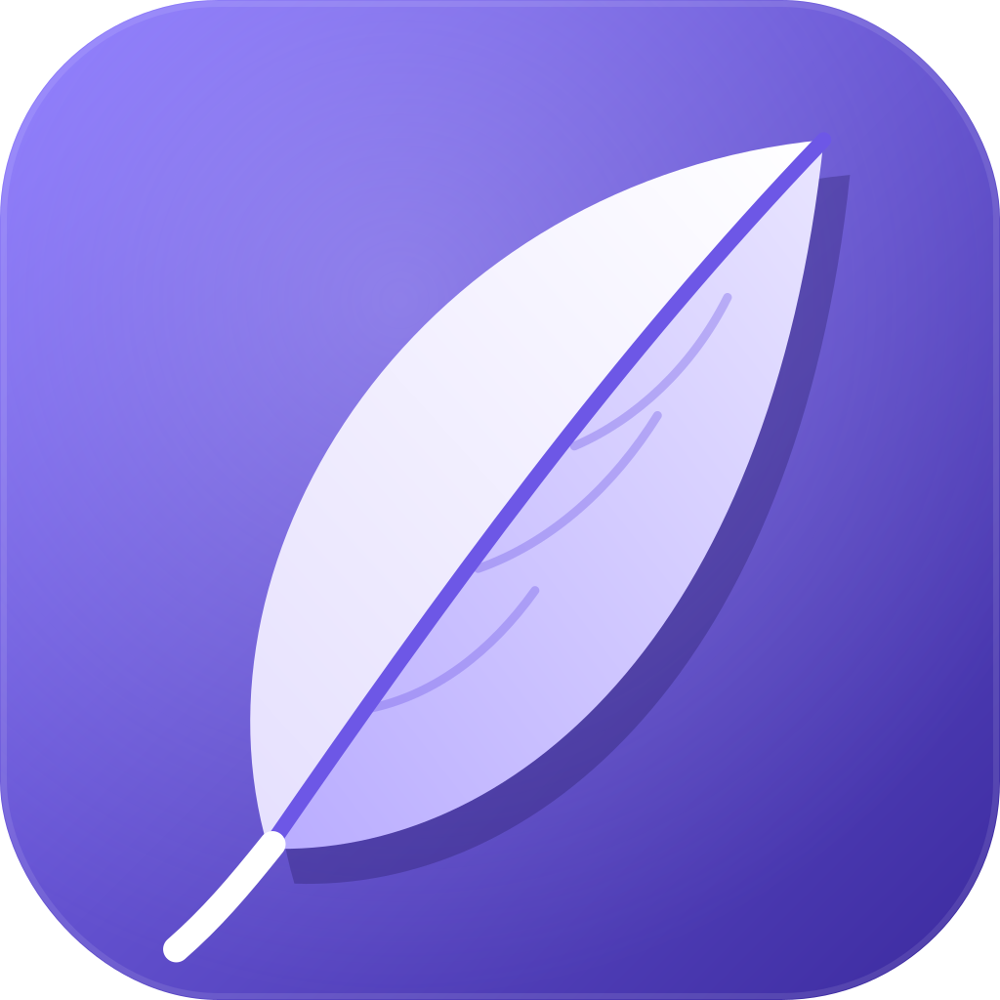
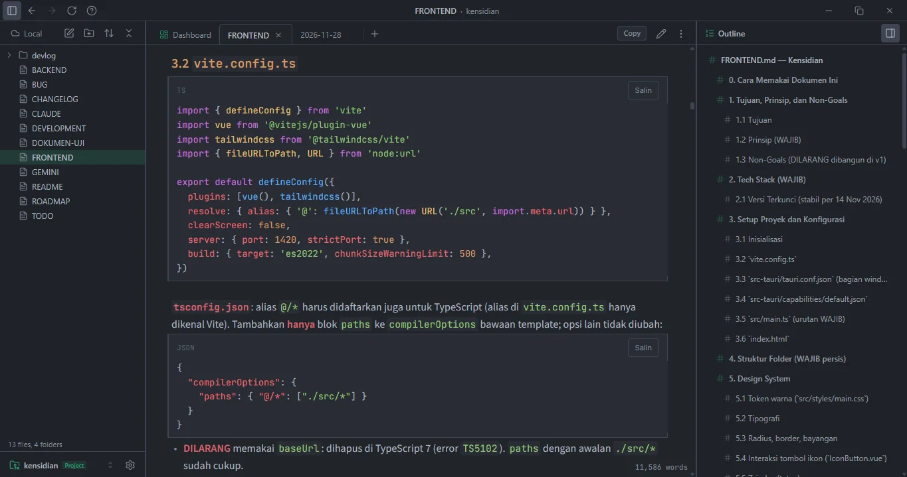
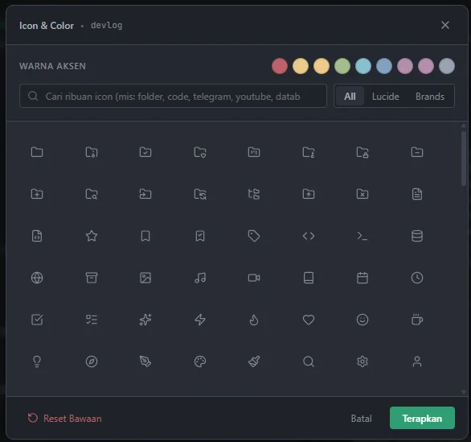
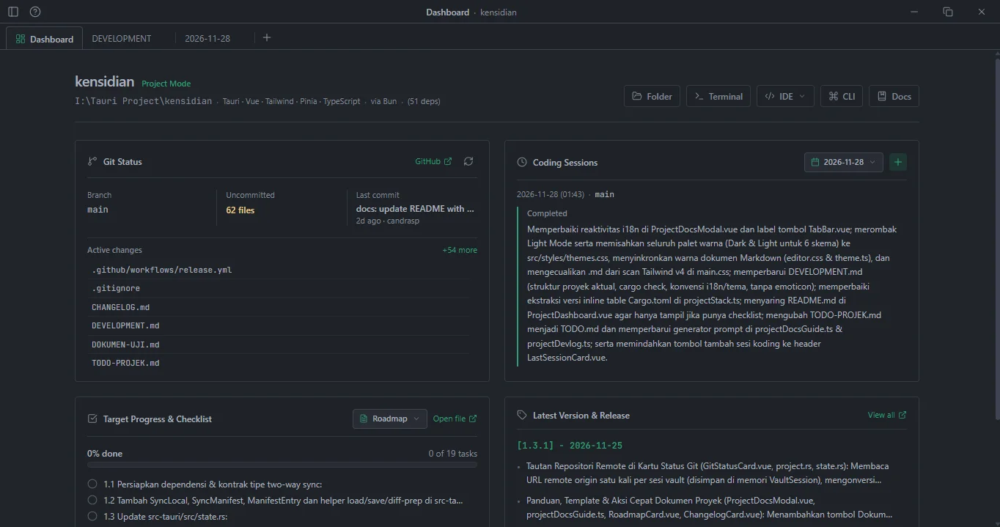
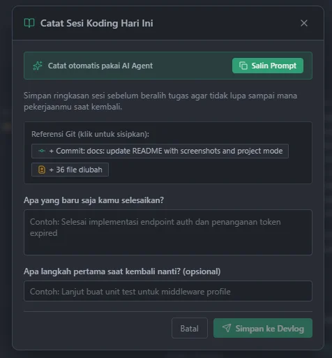

# Kensidian

  <a href="README.md">🇮🇩 Indonesia</a> &nbsp;|&nbsp;
  <a href="README.en.md"><strong>🇬🇧 English</strong></a>

  

  <strong>A lightweight, fast, and elegant local Markdown note-taking app — your coding project companion.</strong> 
  Built with the freedom of Obsidian using <strong>Tauri v2 (Rust)</strong>, <strong>Vue 3</strong>, <strong>TypeScript</strong>, and <strong>Tailwind CSS v4</strong>.

  ⚡ <strong>Lightweight & Native</strong> • 🔒 <strong>100% Local Files</strong> • 🎨 <strong>Flexible Themes & Icons</strong> • 🧑‍💻 <strong>Integrated Project Mode</strong> • 🖥️ <strong>Windows, macOS & Linux</strong>

  

---

## Why Kensidian?

- **100% Yours (Local Files)**: All notes and devlogs are saved as standard Markdown (`.md`) files on your computer using safe atomic writes.
- **Native Performance & Low RAM**: Built on **Tauri v2 (Rust)** using the OS's built-in webview — far lighter than Electron-based apps.
- **Secure & In Control**: Markdown output is sanitized with `DOMPurify`, with delete confirmation and source folder protection in Project Mode.
- **Auto-Updater**: Built-in in-app updater with release notes preview directly inside the app.

---

## ✨ Note-Taking & Markdown Editor Features

### 1. Dual-Mode & Smooth Live Preview
- **Read (View) & Write (Edit) Mode**: Switch instantly with `Ctrl+E` (`Cmd+E` on macOS) or the tab bar button.
- **Accurate Scroll Sync**: Scroll position is synced by source line number — no drift when switching modes.
- **Auto-Save**: Changes are saved automatically after you stop typing. No need to press `Ctrl+S`.
- **Smart Navigation**: Opening existing notes goes straight to View Mode; creating new notes opens Edit Mode.

### 2. Interactive Tables, SVG Code Blocks & Math
- **In-Place Tables**: Edit table cells directly in the editor without reverting to raw Markdown, with `Tab`/`Enter` navigation, add/remove rows and columns, **Show Markdown** button, and one-click delete.
- **Code Blocks & SVG Preview**: Syntax highlighting, copy button, and live visual preview for **SVG** code blocks.
- **Math Notation**: Supports mathematical notation rendering with **KaTeX**.

### 3. Multi-Category Checkbox & Task List
Checkboxes are clickable directly in **View** and **Edit** Mode, with expressive task statuses and a *Dropdown Task Picker* in the Format Toolbar:
- `[ ]` **Todo** • `[x]` **Done** • `[/]` **In Progress** • `[-]` **Cancelled**
- `[>]` **Forwarded** • `[i]` **Info** • `[?]` **Question** • `[!]` **Warning**

### 4. Auto Color Code Detection & One-Click Copy
- Automatically detects **HEX**, **RGB/RGBA**, and **HSL/HSLA** color codes inside your notes.
- Displays an interactive *color swatch* next to the code — click to copy the color code to clipboard instantly.

### 5. One-Click Page Copy (AI Agent-Ready)
- The **Copy** button in the top bar (`Ctrl+Shift+C`) copies the entire raw Markdown document to clipboard in one click.
- Perfect for AI Agent workflows — no need to manually select all text (`Ctrl+A` then `Ctrl+C`).

### 6. Auto Outline, Media & Writing Tools
- **Right Sidebar Outline (`Ctrl+Alt+\`)**: Real-time `H1`–`H6` heading extraction with active heading highlight and smooth scroll.
- **Integrated Image Management**: Paste screenshots from clipboard (`Ctrl+V`) or drag images into the editor (saved to `.kensidian/assets/`), with size controls (25%, 50%, 100% presets, ±50px, or drag *grip handle*).
- **Format Toolbar & Quick Search**: Full format toolbar, Obsidian-style context menu, minimal editor search panel (`Ctrl+F`), and fuzzy **Quick Switcher** (`Ctrl+O`).

---

## 📂 Vault Organization & Personalization

### 7. Drag & Drop File Tree & Vault Management
- **Free Drag & Drop**: Move files/folders into other folders or directly to **Root** with *floating ghost preview*, visual folder highlight, and import from File Explorer.
- **Multi-Select & Flexible Tab Bar**: Supports multi-file selection (`Ctrl`, `Shift`, *marquee selection*), tab reordering, *overflow menu*, and removing vault history without deleting files on disk.

### 8. File Icon & Color Customization
- Personalize every file and folder via right-click → *Change icon & color*.
- Hundreds of **Lucide** and **FontAwesome Brands** icons (GitHub, Figma, Discord, etc.), accent color palette, and real-time icon search.

  

### 9. Themes, Color Schemes, Typography & Language
- **Display Mode**: Dark, Light, and Follow System.
- **6 Color Schemes**: *Nord*, *One Dark*, *Tokyo Night*, *Minimal*, *Catppuccin*, and *Sepia*.
- **Typography & Language**: Font settings for text, code, font size, readable line width, and multi-language UI (**Indonesian** & **English**).

---

## 🧑‍💻 Project Mode (Project Tracker for Solo Developers)

Kensidian can open a **Coding Project Folder** directly from the welcome screen or vault picker with automatic cross-ecosystem detection.

### 10. Integrated Project Dashboard
- **Git Status & Remote Link**: Monitors active branch, last commit, number and list of uncommitted changes (clickable to open), plus a direct link button to the remote repository (GitHub/GitLab).
- **Target Progress & Checklist**: Reads checklists from `ROADMAP.md`, `TODO.md`, `BUG.md`, etc. with progress bar and completed task filter.
- **Latest Version & Release**: Shows the latest release summary directly from `CHANGELOG.md`.
- **Quick Terminal & IDE Access**: Open terminal or detected IDE directly in the project directory.
- **Smart Ignore & Safety Guard**: Automatically hides heavy directories (`node_modules`, `target`, `dist`, `.git`, `.vscode`) and non-Markdown code folders from the file tree, while protecting source folders from accidental deletion.

  

### 11. Coding Session Log (*Devlog*) & AI Agent Prompt
- Log coding progress (*Where I Left Off*) to Markdown files in a `devlog/` folder with a date history picker.
- Includes a one-click copy button for a ready-made AI Agent prompt so your AI assistant can automatically write the session log in the correct dashboard format.

  

### 12. Document Guide, CLI Commands & Tech Stack Detection
- **Project Document Guide & Templates**: View the purpose of standard project documents (`DESIGN.md`, `CONTRACT.md`, `FRONTEND.md`, `BACKEND.md`, `ROADMAP.md`, `CHANGELOG.md`, etc.), generate file templates in one click, or copy an AI Agent prompt.
- **CLI Command Popover**: View and copy `dev`, `build`, `test`, and other commands across ecosystems (JS/TS, Tauri, Rust, Laravel, Go, Python, Flutter, Makefile) in one click.
- **Tech Stack & Dependency Detection**: Automatically detects stack, package manager (`Bun`, `pnpm`, `Yarn`, `npm`), `Monorepo` status, and project dependencies.

---

## 💻 Development (For Developers)

All technical guides for developers — including environment prerequisites, CLI commands (`bun tauri dev`, `bun x tsc --noEmit`, `cargo check`, `bun tauri build`), project architecture, and coding conventions — are available in:

👉 **[DEVELOPMENT.md](DEVELOPMENT.md)**

For the per-version changelog, see **[CHANGELOG.md](CHANGELOG.md)**.

---

## 📄 License

Distributed under the **[GNU General Public License v3.0 (GPL-3.0)](https://github.com/candrasp/Kensidian/blob/main/LICENSE)**.
