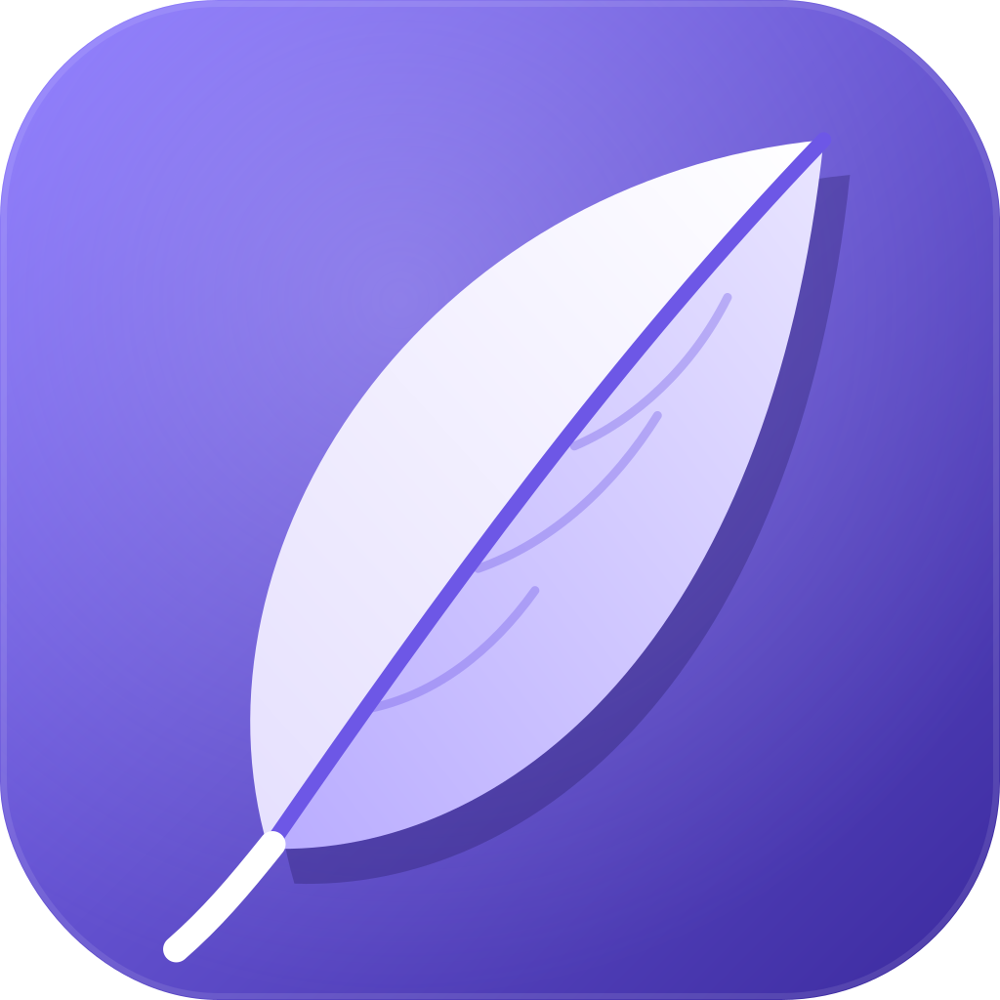
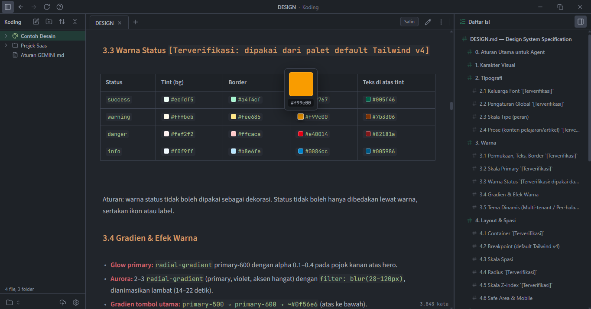
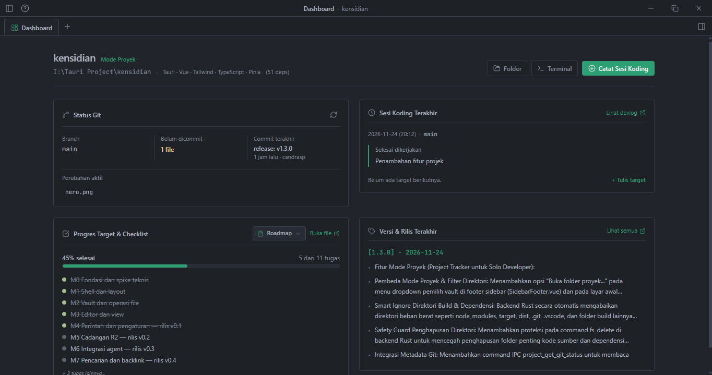

# Kensidian

  

  <strong>Aplikasi Catatan Markdown Desktop Lokal yang Ringan, Super Cepat, dan Elegan.</strong> 
  Dirancang dengan kebebasan penuh ala Obsidian, dibangun dengan arsitektur modern <strong>Tauri v2 (Rust)</strong>, <strong>Vue 3</strong>, <strong>TypeScript</strong>, dan <strong>Tailwind CSS v4</strong>.

  ⚡ <strong>Sangat Ringan</strong> • 🔒 <strong>100% Milikmu (File Lokal)</strong> • 🎨 <strong>Estetis & Kustomisasi Tanpa Batas</strong> • ☁️ <strong>Sinkronisasi Cloudflare R2</strong>

  

---

## ✨ Fitur Unggulan

### 1. 📖 Dual-Mode Markdown & Autosave Otomatis
- **Mode Baca (View) & Mode Tulis (Edit)**: Beralih seketika dengan shortcut `Ctrl+E` atau tombol Titlebar.
- **Tampilan View Bersih & Elegan**: Mode View menyajikan dokumen rendered yang tajam dan nyaman tanpa simbol markdown mentah (`###`, `***`, `- [ ]`) yang mengacaukan pandangan.
- **Autosave Real-Time Tanpa Khawatir**: Perubahan disimpan otomatis ke penyimpanan lokal secara aman (*atomic write*) dalam 100ms setelah Anda berhenti mengetik. Tidak perlu repot menekan `Ctrl+S`.
- **Navigasi Cerdas**: Membuka catatan yang sudah ada otomatis masuk ke Mode View agar siap dibaca; membuat catatan baru otomatis membuka Mode Edit agar langsung siap diketik.

### 2. 📋 Salin Instan Seluruh Halaman (AI Agent-Ready)
- **Satu Klik untuk Seluruh Catatan**: Tombol **Salin** praktis langsung di TitleBar bilah atas untuk menyalin seluruh isi dokumen mentah (*raw markdown*) secara instan.
- **Optimal untuk Alur Kerja AI**: Dirancang khusus bagi pengguna yang sering berkolaborasi dengan Agent AI (ChatGPT, Claude, Gemini, Antigravity, dll.) — tidak perlu lagi repot menyeleksi seluruh teks secara manual (`Ctrl+A` lalu `Ctrl+C`). Cukup satu klik tombol **Salin** atau tekan shortcut `Ctrl+Shift+C`, seluruh isi dokumen langsung siap ditempel (*paste*) ke chat prompt AI.
- **Umpan Balik Visual Halus**: Tombol langsung berubah warna hijau (*emerald*) dengan ikon centang `Tersalin` serta notifikasi toast sebagai konfirmasi bahwa teks berhasil disalin ke clipboard.

### 3. 🎨 Deteksi Kode Warna Otomatis & Salin Sekali Klik
- **Deteksi Universal**: Secara otomatis mengenali format kode warna dalam teks catatan, baik format **HEX** (`#3b82f6`, `#e06c75`), **RGB/RGBA** (`rgba(224, 108, 117, 0.9)`), maupun **HSL/HSLA**.
- **Visual Color Swatch**: Menampilkan kotak warna interaktif tepat di sebelah teks kode warnanya.
- **Hover & Click to Copy**:
  - Arahkan kursor (*hover*) pada kotak warna untuk melihat pratinjau warna secara dinamis.
  - Klik langsung pada kotak warna untuk **menyalin kode warna ke clipboard** seketika disertai notifikasi toast yang halus.

### 4. 📑 Daftar Isi Otomatis (Outline) di Sidebar Kanan
- **Ekstraksi Heading Real-Time**: Sidebar kanan secara otomatis membaca struktur dokumen aktif dari level `H1` hingga `H6`.
- **Hirarki Berjenjang**: Disajikan dengan indentasi berjenjang yang rapi dan elegan sesuai level heading.
- **Smooth Scroll Navigation**: Klik salah satu judul di outline untuk melompat (*smooth scroll*) langsung ke posisi bagian tersebut dalam dokumen.
- **Shortcut Akses Cepat**: Buka dan tutup sidebar kanan kapan saja dengan shortcut `Ctrl+Alt+\`.

### 5. ☑️ Sistem Checkbox & Task List Interaktif Multi-Kategori
- **Bisa Dicentang Langsung**: Checkbox dapat di-klik dan dicentang baik saat berada di **Mode View** maupun **Mode Edit**.
- **Kategori Status Tugas Lengkap**: Tidak hanya sekadar selesai atau belum, Kensidian mendukung penandaan tugas ekspresif dengan ikon dan warna semantik:
  - `[ ]` **Todo** — Belum dikerjakan
  - `[x]` **Done** — Selesai
  - `[/]` **In Progress** — Sedang dikerjakan
  - `[-]` **Cancelled** — Dibatalkan
  - `[>]` **Forwarded** — Dialihkan / Ditunda
  - `[i]` **Info** — Informasi penting
  - `[?]` **Question** — Butuh konfirmasi / Pertanyaan
  - `[!]` **Warning** — Peringatan krusial
- **Dropdown Task Picker**: Tersedia di Format Toolbar untuk memilih status tugas secara instan tanpa perlu mengetik manual.

### 6. 📂 Pohon Berkas Canggih dengan Drag & Drop Interaktif
- **Pindahkan Berkas & Folder Bebas**: Seret berkas untuk memindahkannya masuk ke dalam folder, keluar folder, atau langsung ke tingkat terluar (**Root**).
- **Floating Ghost Preview**: Saat menyeret berkas, kursor menampilkan badge informatif yang mengikuti gerakan mouse secara real-time:
  - Menampilkan nama berkas sumber atau jumlah item (saat multi-select).
  - Tanda panah arah `→` beserta nama folder target atau `Root`.
  - Indikator peringatan jika lokasi pemindahan tidak valid atau sama dengan lokasi asal.
- **Visual Ring Highlight**: Folder tujuan menyala dengan ring aksen tebal yang jelas saat di-hover.
- **Impor Berkas Eksternal**: Seret file teks/markdown langsung dari Windows File Explorer ke pohon berkas untuk mengimpor secara instan.
- **Multi-Selection & Seleksi Area**: Mendukung seleksi banyak berkas sekaligus menggunakan klik `Ctrl`, rentang `Shift`, atau klik-dan-seret area seleksi (*marquee selection*).

### 7. 🏷️ Kustomisasi Ikon & Warna Berkas (Iconize Style)
- **Personalisasi Penuh**: Beri identitas unik pada setiap berkas atau folder melalui menu klik kanan → *Ubah ikon & warna*.
- **Ratusan Pilihan Ikon**:
  - Koleksi ikon esensial **Lucide** (beragam gaya folder, berkas koding, multimedia, sains, status).
  - Koleksi ikon **FontAwesome Brands** (GitHub, YouTube, Discord, Telegram, Figma, Twitter/X, Instagram, dan lainnya).
- **Palet Warna Aksen**: Pilihan warna aksen modern yang selaras dengan tema aplikasi.
- **Pencarian Real-Time**: Temukan ikon yang diinginkan dalam sekejap dengan fitur cari cepat.

### 8. 🖼️ Manajemen Media & Gambar Terintegrasi
- **Tempel Langsung dari Clipboard (Ctrl+V)**: Tangkapan layar (*screenshot*) atau gambar yang disalin dari browser dapat langsung ditempel ke editor. Gambar otomatis tersimpan aman di direktori `.kensidian/assets/`.
- **Drag & Drop Gambar ke Editor**: Seret file gambar dari komputer langsung ke dalam teks catatan.
- **Interactive Image Widget di Mode Edit**: Gambar ditampilkan langsung secara visual di editor pengetikan.
  - Hover gambar untuk memunculkan kontrol ukuran preset (25%, 50%, 100%) dan tombol penyesuaian ukuran ±50px.
  - Dilengkapi *grip handle* di sisi kanan gambar untuk mengubah ukuran secara leluasa dengan mouse drag.

### 9. 🛠️ Toolbar Format Ergonomis & Context Menu Obsidian
- **Format Toolbar Intuitif**:
  - Riwayat: `Undo`, `Redo`
  - Struktur: `Heading ▾` (H1–H6)
  - Format Teks: `Tebal`, `Miring`, `Coret`, `Sorot (Highlight)`, `Kode Inline`, `Tautan (Ctrl+K)`
  - Blok & Daftar: `Kutipan (Quote)`, `Bullet List`, `Numbered List`, `Task Checkbox ▾`
  - Penyisipan Khusus: `Blok Kode`, `Tabel`, `Gambar`, `Garis Pemisah`
- **Obsidian-Style Context Menu**: Menu klik kanan bawaan browser digantikan menu aplikasi yang elegan untuk aksi editing cepat tanpa distraksi.

### 10. 🔍 Quick Switcher & Pencarian Kilat
- Tekan `Ctrl+O` atau klik ikon pencarian di bilah atas untuk membuka **Quick Switcher**.
- Cari dan buka dokumen apa pun di vault secara instan menggunakan pencarian fuzzy.

### 11. 📑 Tab Bar Canggih & Multi-Dokumen
- Buka banyak catatan sekaligus dalam bentuk tab fleksibel.
- Mendukung penataan ulang posisi tab (*tab reorder*), penutupan cepat, dan auto-reveal posisi file di sidebar.
- Dilengkapi dropdown daftar tab saat tab yang terbuka melebihi lebar layar (*overflow menu*).

### 12. ☁️ Pencadangan & Sinkronisasi Cloudflare R2
- Hubungkan vault catatan Anda ke bucket **Cloudflare R2** milik pribadi.
- Menjaga catatan Anda tetap aman, terenkripsi, dan dapat disinkronkan tanpa ketergantungan pada server pihak ketiga berbayar.

### 13. ⚡ Performa Native yang Ekstrem Ringan
- Menggunakan arsitektur **Tauri v2** berbasis bahasa pemrograman **Rust** yang memanfaatkan webview native sistem operasi.
- **Konsumsi RAM Sangat Rendah**: Jauh lebih hemat sumber daya dan ringan dibandingkan aplikasi berbasis Electron.
- Waktu peluncuran (*startup*) instan tanpa lag.

### 14. 🧑‍💻 Mode Proyek & Dashboard Tracker
- **Buka Folder Proyek Koding**: Buka direktori repositori proyek langsung dari pemilih vault atau layar awal dengan deteksi stack teknologi otomatis (*Tauri, Vue, Tailwind, TypeScript, Pinia, dependencies*).
- **Dashboard Proyek Terintegrasi**:
  - **Status Git**: Memantau branch aktif, jumlah file belum dicommit, commit terakhir, serta daftar perubahan aktif yang bisa langsung diklik untuk dibuka.
  - **Sesi Koding Terakhir (*Devlog*)**: Mencatat apa yang sudah selesai dikerjakan dan target langkah berikutnya langsung ke berkas Markdown di folder `devlog/`.
  - **Progres Target & Checklist**: Membaca checklist `- [ ]` / `- [x]` dari file `ROADMAP.md`, `TODO-PROJEK.md`, atau `BUG.md` dengan progress bar otomatis.
  - **Versi & Rilis Terakhir**: Menampilkan ringkasan versi terbaru langsung dari `CHANGELOG.md`.
- **Smart Ignore & Safety Guard**: Backend Rust otomatis mengabaikan direktori berat (`node_modules`, `target`, `dist`, `.git`, `.vscode`) dan melindungi folder kode sumber dari penghapusan tidak sengaja.

  

---

## 🎨 Tema & Personalisasi Tampilan

- **Pilihan Tema**: Mode Gelap (*Dark*), Terang (*Light*), dan Mengikuti Sistem.
- **Skema Warna Populer**: Nord, One Dark Soft, Tokyo Night, Minimal, Catppuccin, dan Sepia.
- **Pilihan Tipografi**:
  - Font Teks: *Inter Variable*, *Plus Jakarta Sans*, *Serif Buku (Merriweather)*, *Bawaan Sistem*.
  - Font Kode: *JetBrains Mono*, *Fira Code*, *Consolas*.

---

## 💻 Panduan Pengembangan (For Developers)

Bagi pengembang yang ingin berkontribusi, menjalankan aplikasi dari kode sumber, atau membangun paket distribusi installer:

👉 Silakan baca petunjuk lengkap di **[DEVELOPMENT.md](DEVELOPMENT.md)**.

---

## 📄 Lisensi

Didistribusikan di bawah lisensi pribadi / proyek Kensidian. Seluruh hak cipta dilindungi.
