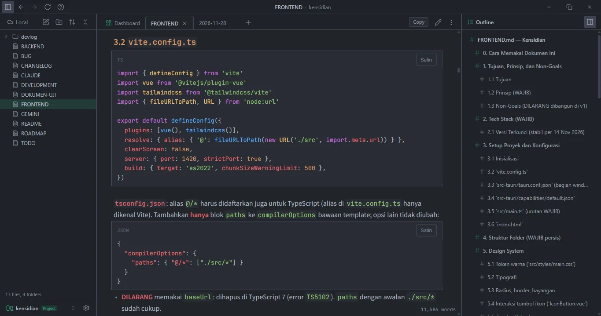
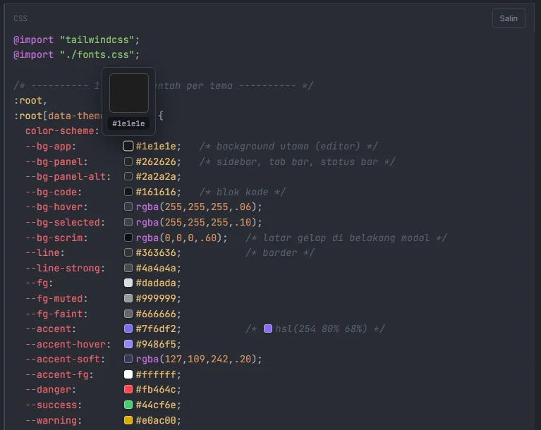
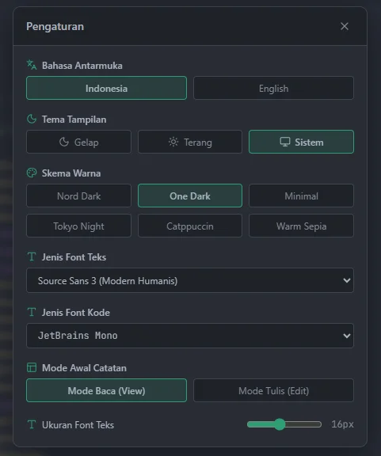
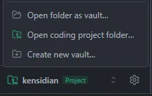
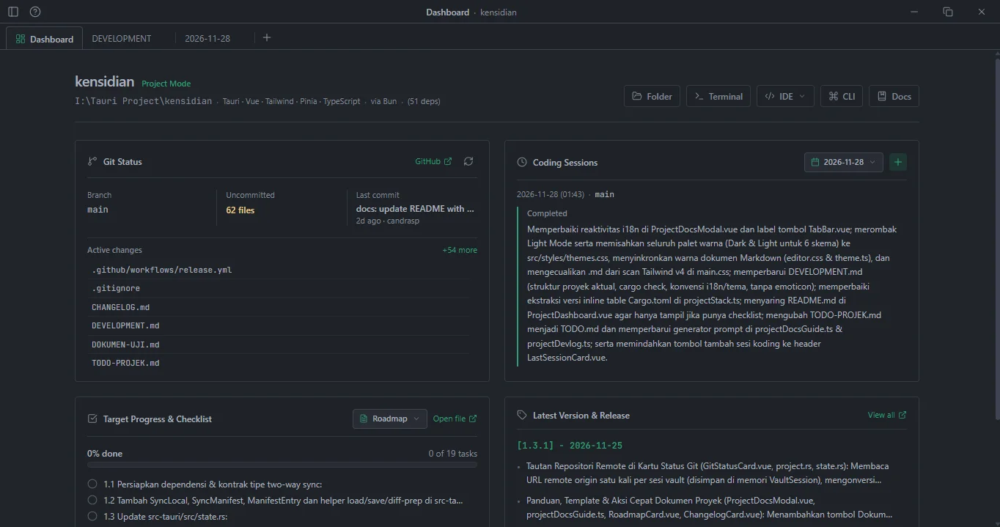
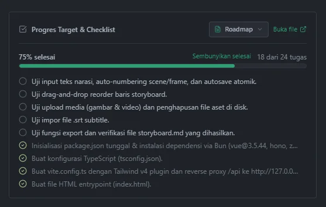
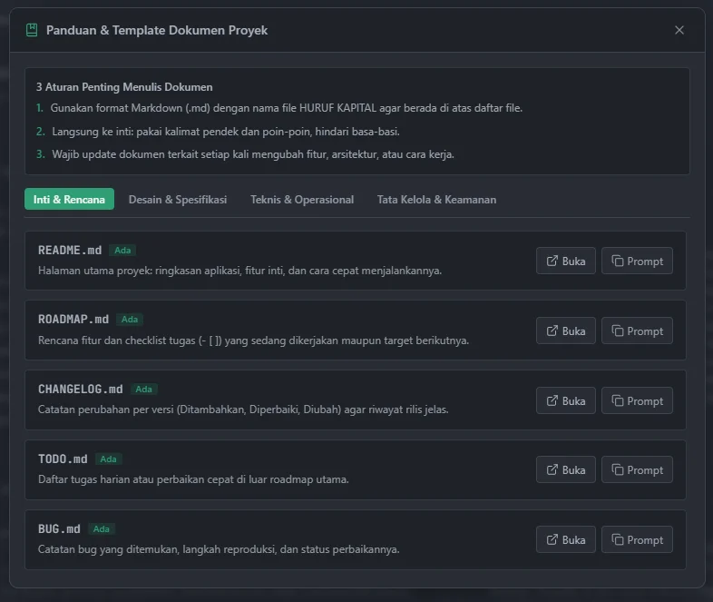
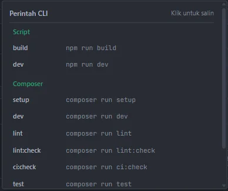
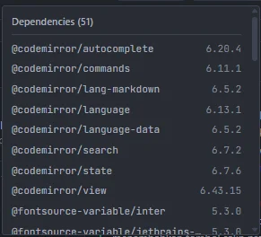

# Kensidian

  

  <strong>Aplikasi Catatan Markdown Desktop Lokal yang Ringan, Cepat, dan Elegan — sekaligus Pendamping Proyek Koding.</strong> 
  Dirancang dengan kebebasan penuh ala Obsidian menggunakan <strong>Tauri v2 (Rust)</strong>, <strong>Vue 3</strong>, <strong>TypeScript</strong>, dan <strong>Tailwind CSS v4</strong>.

  ⚡ <strong>Ringan & Native</strong> • 🔒 <strong>100% File Lokal</strong> • 🎨 <strong>Tema & Ikon Fleksibel</strong> • 🧑‍💻 <strong>Mode Proyek Terintegrasi</strong> • 🖥️ <strong>Windows, macOS & Linux</strong>

  

---

## Mengapa Kensidian?

- **100% Milik Anda (File Lokal)**: Seluruh catatan dan devlog disimpan sebagai berkas Markdown standar (`.md`) di komputer Anda dengan mekanisme penulisan aman (*atomic write*).
- **Performa Native & Hemat RAM**: Dibangun di atas arsitektur **Tauri v2 (Rust)** yang memanfaatkan webview bawaan sistem operasi, jauh lebih ringan dibanding aplikasi berbasis Electron.
- **Aman & Terkendali**: Hasil render Markdown disanitasi dengan `DOMPurify`, dilengkapi konfirmasi penghapusan, serta proteksi folder kode sumber di Mode Proyek.
- **Pembaruan Otomatis**: Mendukung *in-app auto-updater* lengkap dengan pratinjau catatan rilis langsung di dalam aplikasi.

---

## ✨ Fitur Catatan & Editor Markdown

### 1. Dual-Mode & Live Preview Halus
- **Mode Baca (View) & Mode Tulis (Edit)**: Beralih seketika dengan pintasan `Ctrl+E` (`Cmd+E` di macOS) atau tombol di bilah tab.
- **Sinkronisasi Scroll Akurat**: Posisi scroll disinkronkan berbasis nomor baris sumber sehingga tidak bergeser saat berpindah mode.
- **Autosave Otomatis**: Perubahan disimpan otomatis secara aman setelah Anda berhenti mengetik, tanpa perlu menekan `Ctrl+S`.
- **Navigasi Cerdas**: Membuka catatan lama otomatis masuk ke Mode View agar siap dibaca; membuat catatan baru langsung masuk ke Mode Edit.

### 2. Tabel Interaktif, Blok Kode SVG & Matematika
- **Tabel In-Place**: Edit sel tabel langsung di editor tanpa terbongkar menjadi teks mentah, lengkap dengan navigasi `Tab`/`Enter`, tambah/hapus baris dan kolom, tombol **Show Markdown**, serta hapus tabel satu klik.
- **Blok Kode & Pratinjau SVG**: Dilengkapi *syntax highlighting*, tombol salin kode, serta pratinjau visual langsung untuk blok kode **SVG**.
- **Rumus Matematika**: Mendukung penulisan notasi matematika dengan **KaTeX**.

### 3. Sistem Checkbox & Task List Multi-Kategori
Checkbox dapat diklik langsung di **Mode View** maupun **Mode Edit**, dengan dukungan status tugas ekspresif dan *Dropdown Task Picker* di Format Toolbar:
- `[ ]` **Todo** • `[x]` **Done** • `[/]` **In Progress** • `[-]` **Cancelled**
- `[>]` **Forwarded** • `[i]` **Info** • `[?]` **Question** • `[!]` **Warning**

### 4. Deteksi Kode Warna Otomatis & Salin Sekali Klik
- Mengenali format kode warna **HEX**, **RGB/RGBA**, dan **HSL/HSLA** secara otomatis di dalam catatan.
- Menampilkan kotak pratinjau warna (*color swatch*) interaktif di sebelah kode warna — klik untuk langsung menyalin kode warna ke clipboard.

  

### 5. Salin Instan Seluruh Halaman (AI Agent-Ready)
- Tombol **Salin** di bilah atas (`Ctrl+Shift+C`) menyalin seluruh isi dokumen Markdown mentah ke clipboard dalam satu klik.
- Praktis untuk alur kerja bersama AI Agent tanpa perlu menyeleksi teks secara manual (`Ctrl+A` lalu `Ctrl+C`).

### 6. Daftar Isi Otomatis (Outline), Media & Alat Tulis Cepat
- **Outline Sidebar Kanan (`Ctrl+Alt+\`)**: Ekstraksi heading `H1`–`H6` secara real-time dengan highlight heading aktif dan *smooth scroll*.
- **Manajemen Gambar Terintegrasi**: Tempel screenshot langsung dari clipboard (`Ctrl+V`) atau seret gambar ke editor (tersimpan rapi di `.kensidian/assets/`), lengkap dengan kontrol ukuran visual (preset 25%, 50%, 100%, ±50px, atau drag *grip handle*).
- **Toolbar Format & Pencarian Cepat**: Format toolbar lengkap, context menu bergaya Obsidian, panel pencarian editor (`Ctrl+F`) minimalis, serta **Quick Switcher** (`Ctrl+O`) berbasis pencarian fuzzy.

---

## 📂 Organisasi Vault & Personalisasi

### 7. Pohon Berkas Drag & Drop & Manajemen Vault
- **Drag & Drop Bebas**: Pindahkan berkas/folder masuk ke folder lain atau langsung ke **Root** dengan *floating ghost preview*, visual highlight folder target, dan impor berkas eksternal dari File Explorer.
- **Multi-Seleksi & Tab Bar Fleksibel**: Mendukung seleksi banyak berkas (`Ctrl`, `Shift`, *marquee selection*), penataan ulang tab, *overflow menu*, serta hapus riwayat vault dari daftar sesi tanpa menghapus berkas fisik di disk.

### 8. Kustomisasi Ikon & Warna Berkas
- Personalisasi setiap berkas dan folder melalui menu klik kanan → *Ubah ikon & warna*.
- Tersedia ratusan pilihan ikon **Lucide** dan **FontAwesome Brands** (GitHub, Figma, Discord, dll.), palet warna aksen, serta pencarian ikon real-time.

  

### 9. Tema, Skema Warna, Tipografi & Bahasa
- **Mode Tampilan**: Gelap (*Dark*), Terang (*Light*), dan Mengikuti Sistem.
- **6 Skema Warna**: *Nord*, *One Dark*, *Tokyo Night*, *Minimal*, *Catppuccin*, dan *Sepia*.
- **Tipografi & Bahasa**: Pengaturan font teks, font kode, ukuran huruf, lebar baris baca, serta antarmuka multi-bahasa (**Indonesia** & **Inggris**).

  

---

## 🧑‍💻 Mode Proyek (Project Tracker untuk Solo Developer)

Kensidian dapat membuka **Folder Proyek Koding** secara langsung melalui layar awal atau pemilih vault dengan deteksi otomatis lintas ekosistem.

  

### 10. Dashboard Proyek Terintegrasi
- **Status Git & Tautan Remote**: Memantau branch aktif, commit terakhir, jumlah dan daftar perubahan yang belum dicommit (bisa langsung diklik untuk dibuka), serta tombol tautan langsung ke repositori remote (GitHub/GitLab).
- **Progres Target & Checklist**: Membaca checklist dari `ROADMAP.md`, `ROADMAP-BARU.md`, `TODO-PROJEK.md`, `TODO.md`, dan `BUG.md` lengkap dengan progress bar dan filter tugas selesai.
- **Versi & Rilis Terakhir**: Menampilkan ringkasan rilis terbaru langsung dari `CHANGELOG.md`.
- **Akses Cepat Terminal & IDE**: Buka terminal atau IDE yang terdeteksi langsung di direktori proyek.
- **Smart Ignore & Safety Guard**: Otomatis menyembunyikan direktori berat (`node_modules`, `target`, `dist`, `.git`, `.vscode`) serta folder kode non-Markdown dari pohon berkas, dan melindungi folder sumber dari penghapusan tidak sengaja.

  

  

### 11. Catatan Sesi Koding (*Devlog*) & Prompt AI Agent
- Catat progres sesi koding (*Where I Left Off*) ke berkas Markdown di folder `devlog/` dengan pemilih tanggal riwayat sesi.
- Dilengkapi tombol salin prompt AI Agent siap pakai agar asisten AI dapat menuliskan ringkasan sesi koding secara otomatis sesuai format dashboard.

  

### 12. Panduan Dokumen, Perintah CLI & Deteksi Tech Stack
- **Panduan & Template Dokumen Proyek**: Lihat fungsi dokumen standar proyek (`DESIGN.md`, `CONTRACT.md`, `FRONTEND.md`, `BACKEND.md`, `ROADMAP.md`, `CHANGELOG.md`, dll.), buat file template 1-klik, atau salin prompt AI Agent.
- **Popover Perintah CLI**: Lihat dan salin perintah `dev`, `build`, `test`, dan lainnya lintas ekosistem (JS/TS, Tauri, Rust, Laravel, Go, Python, Flutter, Makefile) dalam satu klik.
- **Deteksi Tech Stack & Dependensi**: Mengenali stack teknologi, package manager (`Bun`, `pnpm`, `Yarn`, `npm`), status `Monorepo`, serta daftar dependensi proyek secara otomatis.

  

  

  

---

## 💻 Pengembangan (For Developers)

Seluruh panduan teknis untuk pengembang — termasuk prasyarat lingkungan, perintah CLI (`bun tauri dev`, `bun x tsc --noEmit`, `cargo check`, `bun tauri build`), struktur arsitektur proyek, dan konvensi koding — tersedia lengkap di:

👉 **[DEVELOPMENT.md](DEVELOPMENT.md)**

Untuk daftar pembaruan per versi, silakan lihat **[CHANGELOG.md](CHANGELOG.md)**.

---

## 📄 Lisensi

Didistribusikan di bawah lisensi **[GNU General Public License v3.0 (GPL-3.0)](https://github.com/candrasp/Kensidian/blob/main/LICENSE)**.
